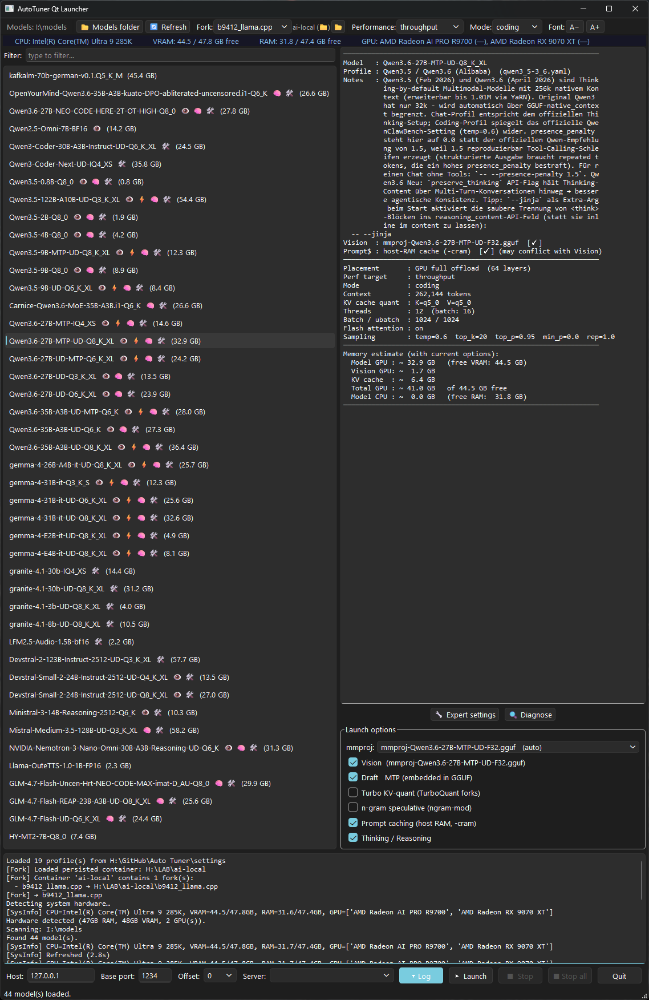

# AutoTuner for llama.cpp

Interactive launcher for `llama-server` that **detects your hardware**,
**scans your local GGUF collection**, and **auto-tunes** context length,
KV-cache quantization, GPU offload, threading, and batch size to fit in
the RAM/VRAM you actually have free — without manual edits.

# GUI-Design

GUI:


Performance Test Result:


**Live benchmark dashboard:** [See how the tested models run on the maintainer's hardware](https://dawasteh.github.io/Auto-Tuner/).

## Features

- **Interactive terminal menu** — pick from whatever GGUFs are in your
  models folder, no editing required.
- **End-to-end OCR documents (GUI + TUI)** — OCR models get a 📄 action that
  accepts images, multi-frame TIFF/GIF, PDF, Word/Office/OpenDocument,
  presentation, spreadsheet, or whole-folder input. Office files are converted
  with LibreOffice **before** the model claims RAM; PDFs are rendered with
  PyMuPDF; pages are normalized with Pillow and sent through llama-server's
  multimodal API. Per-page files, a combined Markdown/text result, and a hashed
  JSON manifest go to the selected output folder. The source documents are
  never modified.
- **Visible throughput logs** — AutoTuner emits `--perf` on current
  llama.cpp builds so the separate terminal keeps showing prompt/eval
  timings and tokens/s; append `--no-perf` if you want quieter logs.
- **Hardware auto-detection** — works on **AMD (ROCm)**, **NVIDIA**,
  **Intel**, and **Apple Silicon** (unified memory). Multi-GPU is
  supported via automatic `--tensor-split`. The split strategy depends on
  the model type:
  - **Dense** models use a **priority-weighted** split: a model that fits
    the largest card is pinned to it (the second GPU stays free for
    gaming/OBS); larger models put the bulk of the weights on the
    high-priority card.
  - **MoE** models that don't fit the primary card alone use a
    **capacity-fill** split instead — both GPUs are packed to roughly the
    same utilisation so the maximum number of expert layers stays resident
    in VRAM (every expert that lands on the GPU instead of spilling to CPU
    via `--n-cpu-moe` is a real speed win). This replaces the old
    priority-weighted behaviour for MoE, which stranded several GB on the
    secondary card and slowed the model down.

  Device visibility is derived from the selected binary's own
  `--list-devices` table. AutoTuner emits only that backend's selector
  (`HIP_VISIBLE_DEVICES` or `GGML_VK_VISIBLE_DEVICES`) when known, so HIP and
  Vulkan's different physical-device order cannot silently select the wrong GPU.
- **Free-memory aware, Q8-first KV** — Auto prefers symmetric `q8_0` for
  long-context and tool-calling quality, without spending spare memory on
  F16/BF16. Q4 is only a fallback when Q8 cannot hold the target context;
  incompatible runners/head dimensions use F16. Placement and context follow
  currently free RAM/VRAM, and manual Expert K/V pins remain authoritative.
- **Per-family YAML profiles** in `settings/` — override sampling,
  max context, chat template, and llama-server flags per model family.
  Easy for contributors to extend without touching Python. Each profile's
  `notes` explanation is shown in the configuration preview and follows the
  interface language through the language packs' `profile_notes`.
- **Companion-file auto-pairing** — sibling files don't pollute the
  model menu, they're attached to their main model:
  - `mmproj` projectors → vision (longest-prefix wins). The `mmproj`
    marker is detected **anywhere in the filename**, not just as a
    leading `mmproj-` prefix — so a projector named with the marker
    mid-name (e.g. `qwen3.6-35b-a3b-mxfp4-moe-mmproj-f16.gguf`, where the
    vendor put the quant label before `mmproj`) is now paired correctly.
    Projectors saved with a literal **`.mmproj` extension** (some audio
    projectors) are picked up too, even though they don't match the
    `*.gguf` glob. Matching is separator-tolerant (`-moe` vs `_moe` no
    longer blocks a pair) but still size-specific, so a 2B model never
    grabs a 0.8B projector. When a model ships **several projector
    precisions** side by side (`…-bf16`, `…-f16`, `…-f32`), all are kept
    as candidates and a **dropdown** in the Launch options lets you switch
    between them. The auto pick prefers the **highest precision**
    (f32 > f16 > bf16) on an otherwise-equal name match; your manual
    choice is remembered per model.
  - `*-assistant-*.gguf` / `*-draft-*.gguf` / `mtp-*.gguf` / `dspark-*.gguf`
    → speculative decoding (smallest matching sibling wins). A leading `mtp-`
    explicitly marks an external draft head even when newer Qwen-based heads
    are several GiB; large infix `…-MTP-…` target models remain normal runnable
    models. EAGLE-3, DFlash, and b10329 DSpark sidecars are also classified from
    GGUF architecture/tensor metadata and receive their required `--spec-type`.
- **Themes and appearance editor** — choose built-in System, Dark, Dark Gray, Light, High Contrast, or the pink-accented Midnight Rose theme in **⚙ Settings**, or copy one in the in-app color/font editor and save it as a safe JSON user theme. See the complete [theme guide](docs/themes.md).
- **Favorite models stay at the top** — click the star left of a model name
  to mark it. Active and inactive star colors follow the selected theme, and
  the choice is persisted across AutoTuner restarts.
- **Persistent folder tree** — folders and the Favorites section start open,
  but every branch you manually open or close keeps that exact state when you
  switch list/folder views and after restarting AutoTuner.
- **Capability badges in the model list** — symbols make it obvious
  what each model can do at a glance:
  - 👁 vision (mmproj projector paired)
  - ⚡ draft  (assistant sibling for speculative decoding)
  - 🧠 thinking (chat template emits `<think>` / `reasoning_content`)
  - 🛠 tool-use (chat template advertises `tool_calls` / `function_call`)
  - 📄 OCR/document parsing (known OCR architecture/name)

  Detection reads the GGUF chat template directly — no name-based
  guessing — so `Qwen3-Coder` (no thinking) and `Qwen3-Embedding`
  (neither thinking nor tools) are correctly excluded.
- **Model actions on right-click** — choose **GGUF-Ordner öffnen** to open the
  containing directory, or use **Expert Settings kopieren/einfügen** to transfer
  the active performance mode's complete Expert snapshot to another model. The
  internal clipboard retains the source mode (`safe`, `balanced`, `throughput`,
  or `low_vram`) so settings cannot silently land in a different mode.
- **Reads GGUF metadata** — pulls `n_layers` and `context_length`
  straight from the file so partial GPU offload (`-ngl`) is exact.
- **Author-recommended samplers from GGUF metadata** — many models embed
  their recommended sampler defaults in `general.sampling.*`
  (e.g. Qwen3.5/3.6 ship `temp 1.0 / top_k 20 / top_p 0.95`). The tuner
  now reads these and uses them to fill any sampling value a matched YAML
  profile leaves unspecified. Priority per field is: a **matched family
  profile's explicit value** wins first (these are hand-tuned), then the
  **GGUF recommendation**, then the generic default. The practical effect:
  a model with **no tailored profile** (so it would otherwise fall back to
  the generic `temp 0.7 / top_k 40`) now runs on its intended samplers —
  a frequent cause of repetition loops and broken tool-calls on models
  tuned for a low `top_k` with a non-zero `min_p`.
- **Six setting profiles per model and performance mode** — switch between
  untouched **Auto**, benchmarked **Perform**, and four renameable **Custom**
  profiles. Editing Auto/Perform forks safely into a free Custom slot, and each
  non-Auto slot stores independent variants per drafter/MTP head.
- **Measured performance suite** — click **🚀 Performance test** to run
  **Quick** (≤3.125% ctx / 16k prompt / 128 decode), **Standard** (12.5% / 64k
  prompt), or **Custom** (0.01–100% uncapped) benchmarks using isolated
  `llama-server` runs, `/tokenize`-calibrated prompts, and atomic checkpoints
  with graceful **Stop after Model / Mode** boundaries. Results are cached by
  exact binary, backend, devices, and placement; Settings → **Performance
  profiles** exports/imports the portable profile bank. AutoTuner never changes
  clocks, voltage, fan curves, or power limits.
- **Graphical performance report + public benchmark page** — **📊 Performance
  report** writes a self-contained HTML dashboard under `~/.autotuner/reports`.
  `python publish_benchmarks.py` exports a path-redacted static snapshot to
  `benchmark-site/` for the
  [public GitHub Pages dashboard](https://dawasteh.github.io/Auto-Tuner/)
  ([guide](docs/benchmark-pages.md)).
- **Fast startup and cached metadata** — GGUF headers are scanned in parallel
  with hardware probing and cached under `~/.autotuner/cache` by path/size/mtime.
- **Diagnostics & debug mode** — **🔍 Diagnose** shows KV/MoE/hybrid analysis
  and can generate a redacted support report or full Markdown GGUF inventory in
  `~/.autotuner/reports`. Settings offers an opt-in **Debug mode** without
  enabling server prompt logging.
- **Multi-server with GPU load-balancing** — launch several models concurrently
  on sequential free ports (`1234`, `1235`, `1236`, …). Additional models
  re-read live VRAM, steer onto the emptier card, and refuse with a clear
  message if no GPU has room.
- **Host-memory prompt caching (`--cache-ram`)** — auto-enabled with a 2048 MiB
  default cap (editable in GUI or `--cache-ram-mib`), including vision caching
  on `b10045+` builds.
- **Sticky GUI choices, layout, font & single instance** — per-model mmproj,
  draft/MTP, thinking, n-gram, prompt-cache, target, Expert overrides, window
  geometry, splitter positions, fork parent folder, and global font size
  persist in `~/.autotuner/autotuner_settings.json`. Settings also controls
  per-user login autostart, optional *Start minimized after login*, and
  *Hide on close* to the tray. A second launch raises the existing instance
  instead of opening a duplicate (`AUTOTUNER_ALLOW_MULTIPLE_INSTANCES=1`
  disables the guard).
- **Reasoning controls** — per-model Effort (`auto` / `off` / `minimal` / `low`
  / `medium` / `high` / `extra_high`), Think-budget (`--reasoning-budget`), and
  optional `--reasoning-preserve` live in the Expert panel.

### Vision control

You can disable vision (mmproj) support in two ways:

1. **Command-line flag**:

   ```bash
   python auto_tuner.py --model "Qwen3.6" --novision
   ```

2. **GUI checkbox** in *Launch options*. A second checkbox can keep an
   active projector in system RAM (`--no-mmproj-offload`); the memory preview
   then moves its footprint from VRAM to RAM. When the model ships several
   projector precisions (`…-bf16` / `…-f16` / `…-f32`), an **mmproj
   dropdown** appears above the checkboxes so you can pick which one to
   load. The chosen projector is remembered per model in
   `autotuner_settings.json` under `mmproj_selection`. The auto pick
   defaults to the highest precision available.

> **Note on prompt caching + vision:** llama.cpp **b10045+** can cache
> multimodal prompts. AutoTuner enables it on those builds; older or
> unprobeable binaries safely fall back to `--cache-ram 0` while Vision is
> active. This was runtime-verified on b10058 with a repeated Gemma 4 image
> request (`cached_tokens`: 0 → 279).

### OCR documents

The shared GUI/TUI presets use the publishers' task prompts: GLM-OCR
`Text Recognition:`, PaddleOCR-VL `OCR:`, and dots.ocr
`Extract the text content from this image.` You can still override the prompt.

Select an OCR model with its matching mmproj (for example
`Unlimited-OCR-BF16.gguf` + `mmproj-Unlimited-OCR-F16.gguf`). In the Qt GUI,
click **📄 OCR…** or double-click the OCR model. Choose one or more files/folders,
an output folder, PDF page range, DPI, output format, and token budget. The GUI
converts/prepares documents first, loads the model, verifies the server's model
alias, shows page progress, and optionally releases the server/VRAM afterward.

Terminal equivalent:

```bash
python auto_tuner.py \
  --model "Unlimited-OCR" \
  --ocr-input document.pdf \
  --ocr-input scans/ \
  --ocr-output ocr-results \
  --ocr-pages 1-5 \
  --ocr-dpi 220 \
  --ocr-max-tokens 4096 \
  --non-interactive --yes
```

PDF rendering requires PyMuPDF and image normalization requires Pillow (both are
installed by `requirements.txt`). Word/Office/OpenDocument input additionally
requires a local LibreOffice installation; without it AutoTuner gives a clear
error and leaves the source untouched. Unlimited-OCR uses its verified
`document parsing.` prompt, compatible F16 KV with Flash Attention off,
deterministic sampling, and requires llama.cpp b10287+. **There is no CMake/build flag for `max_tiles=32`.** The value
comes from the projector GGUF metadata. For the full 32-tile Unlimited-OCR
path, the mmproj must contain `clip.vision.preproc_max_tiles=32`; AutoTuner
warns when an older projector would silently fall back to 9 tiles. Reconvert
Unlimited-OCR's mmproj with a current `convert_hf_to_gguf.py --mmproj` (the
current converter writes 32 automatically), or download a newly converted
projector. Rebuilding `llama-server` cannot repair an old mmproj.

AutoTuner's OCR workflow uses the persistent OpenAI-compatible HTTP server, not
`llama-mtmd-cli`. Therefore a llama.cpp directory is shown in the fork picker
only after it contains `build/bin/Release/llama-server.exe` (or the native
Linux/macOS binary). `building llama.cpp/ocr_vulkan_llama_build.ps1` and
`ocr_hip_llama_build.ps1` build both `llama-server` and `llama-mtmd-cli` from
the exact reviewed legacy PR #17400 commit; that old fork remains for
DeepSeek-OCR v1. Unlimited-OCR should use either current mainline recipe,
`llama_prerelease_vulkan_build.ps1` or `llama_prerelease_hip_build.ps1`.

## Installation

```bash
git clone https://github.com/DaWasteh/Auto-Tuner.git
cd "Auto-Tuner"
pip install -r requirements.txt
```

You also need a working `llama-server` binary. The tuner automatically discovers binaries in common local setups (like `C:\LAB\ai-local\`), or you can specify one via `--server`.

## Update (GUI-Button oder Terminal)

In der Qt-GUI gibt es oben in der Toolbar den Button **⬆ Update**. Die laufende
Version steht im Fenstertitel sowie in den Update-Dialogen und -Meldungen. In einem
Source-Start prüft er den Git-Branch beziehungsweise das GitHub-Source-ZIP, nicht
Release-Assets. In einem echten `git clone` nutzt
er `git pull --ff-only`; in einem heruntergeladenen ZIP/Release-Ordner ohne
`.git` lädt er automatisch das aktuelle GitHub-Source-ZIP herunter und spielt
es über die bestehende Installation. Bei geänderter `requirements.txt` führt
er automatisch `pip install -r requirements.txt` aus. Vor dem Update wird
`autotuner_settings.json` gesichert und danach wiederhergestellt — deine
lokalen Pfade, Ports, Overrides und UI-Einstellungen werden also nicht
überschrieben (auch bei älteren Klonen, in denen die Datei noch versehentlich
von Git getrackt wird). Nach einem erfolgreichen Update AutoTuner neu starten.

Danke für die Update-Button-Idee an [nextscript](https://github.com/nextscript).

Wenn du AutoTuner per `git clone` installiert hast, kannst du neue Versionen
weiterhin über das Terminal holen. Deine persönlichen Einstellungen bleiben
auch dabei erhalten: Python-Start und kompilierte App verwenden gemeinsam
`~/.autotuner/autotuner_settings.json`.

**1. In den App-Ordner wechseln** (dorthin, wo du geklont hast):

```bash
cd "H:/GitHub/Auto Tuner"
```

**2. Aktuelle Änderungen herunterladen:**

```bash
git pull
```
Falls du lokal an den Python-Dateien herumgepfuscht hast und `git pull`
mit einem Konflikt abbricht, kannst du deine lokalen Änderungen
verwerfen und den Upstream-Stand übernehmen:

```bash
git stash            # lokale Änderungen kurz beiseite legen
git pull
git stash drop       # beiseite gelegte Änderungen verwerfen
# oder: git stash pop  → Änderungen wiederherstellen (evtl. Konflikte lösen)
```

> ⚠️ In aktuellen Klonen ist `autotuner_settings.json` gitignored; `git stash`
> berührt sie dann nicht. Wenn dein alter Klon die Datei noch als geändert
> anzeigt, nutze bevorzugt den **⬆ Update**-Button — er sichert und restored
> die Datei explizit.

**3. Abhängigkeiten aktualisieren** (nur nötig, wenn sich `requirements.txt`
geändert hat — schadet aber nie):

```bash
pip install -r requirements.txt
```
Falls du eine virtuelle Umgebung nutzt, aktiviere sie vorher. Projekt-Konvention:
Windows nutzt `.venv`, Ubuntu/Linux nutzt `.venv_linux`.

```bash
# Ubuntu/Linux
python3 -m venv .venv_linux
.venv_linux/bin/python -m pip install -r requirements.txt
source .venv_linux/bin/activate
```

```bat
REM Windows
py -m venv .venv
.venv\Scripts\activate
pip install -r requirements.txt
```

**4. App starten** — danach einfach wie gewohnt:

```bash
python qt_launcher.py        # GUI
# oder
python auto_tuner.py         # Terminal
```

**Kurzform** (wenn sich nichts an den Abhängigkeiten geändert hat):

```bash
git pull && python qt_launcher.py
```

## Compiled build (.exe / Linux binary)

Für Einsteiger gibt es kompilierte **noconsole**-Versionen ohne separate
Python-Installation: **Windows 10/11 x64** (`.exe`), **Linux x64** und
**macOS Apple Silicon arm64**. Der Linux-Build wird bei jedem Release
automatisiert auf **Ubuntu, Fedora, Arch Linux, Linux Mint, CachyOS, Kali
Linux und Debian** gestartet; Windows und macOS erhalten zusätzlich einen
nativen Frozen-Binary-Smoke-Test. Alle drei Builds verwenden denselben
**⬆ Update**-Button.

Der macOS-Build ist derzeit nicht mit einer kostenpflichtigen Apple Developer
ID signiert/notarisiert. Gatekeeper kann deshalb beim ersten Start warnen:
App im Finder mit **Rechtsklick → Öffnen** starten und die Rückfrage bestätigen;
falls nötig unter **Systemeinstellungen → Datenschutz & Sicherheit → Dennoch
öffnen** freigeben. Nur das Asset aus dem offiziellen AutoTuner-GitHub-Release
verwenden. Intel-Macs und ARM-Linux sind derzeit Source-Installationen, keine
bereitgestellten Frozen-Assets.

### Bauen

PyInstaller kann nicht cross-kompilieren — die `.exe` wird **auf Windows**,
der Linux-Binary **auf Linux** und der macOS-Build **auf macOS** erzeugt. Alle
landen als Assets im selben GitHub-Release. GitHub Actions prüft den Quellcode
zusätzlich in nativen Containern der oben genannten Linux-Distributionen.

```bash
# einmalig im Build-Environment:
python -m pip install pyinstaller
python -m pip install -r requirements.txt

# dann das jeweilige Binary bauen:
python build_exe.py
# → Windows: dist/AutoTuner.exe   |   Linux: dist/AutoTuner-Linux
```

`build_exe.py` bündelt `settings/*.yaml` und das App-Icon aus `assets/` als
read-only Daten mit; unter Windows wird `assets/AutoTuner.ico` zusätzlich in
die `.exe` eingebettet. Python- und Frozen-Starts teilen Einstellungen,
Benchmarkdaten, Themes, Reports und Logs unter `~/.autotuner` (Windows z. B.
`C:\Users\Name\.autotuner`). Beim ersten v5.2.8-Start werden ältere Dateien
aus Source- und EXE-Ordnern zusammengeführt und unverändert gesichert.

### Release / Auto-Update

1. `autotuner_version.py` → `VERSION` hochzählen (z. B. `"1.1.0"`).
2. Commit + Tag **`v1.1.0`** (das Tag-Format `v<VERSION>` ist Pflicht — der
   Updater streift das führende `v` vor dem Vergleich).
3. Der Release-Workflow erstellt die drei ZIP-Assets für Windows, Linux und
   macOS. Veröffentlicht wird erst, nachdem das Linux-Binary die Smoke-Tests
   auf allen unterstützten Distributionen bestanden hat.
4. Der Update-Button in der kompilierten Version holt sich automatisch das
   zum laufenden OS passende Asset, lädt es herunter und tauscht das Binary
   über einen Swap-Shim nach Neustart aus (Windows sperrt die laufende `.exe`,
   deshalb der Shim; auf Linux geht das direkte `mv` über das laufende ELF).

> Source-Installationen (Entwickler) nutzen weiterhin den git/ZIP-Updater; die
> kompilierte Version wählt automatisch den Binary-Swap-Pfad (`sys.frozen`).

## Usage

Point it at a folder of `*.gguf` models — it will recurse:

```bash
python auto_tuner.py --models-path /path/to/models
```

Or set the environment variable once:

```bash
export AUTOTUNER_MODELS=/path/to/models     # Linux / macOS
setx  AUTOTUNER_MODELS  D:\models           # Windows
python auto_tuner.py
```

Pick a model from the menu. Once it's running, point your client at:

```
http://127.0.0.1:1234
```

Works with the built-in **llama.cpp Web UI**, **VS Code** extensions
like Continue / Cline, **Open WebUI**, or any OpenAI-API client.

### Terminal TUI

```bash
python auto_tuner.py
```

The dependency-free terminal interface is designed for enthusiasts who prefer a
fast keyboard workflow. It shows the shared **AutoTuner version**, responsive
model cards, capability badges, the active performance target/GPU pin, and a
compact memory/config summary. ANSI color is used only in compatible TTYs;
logs, pipes, and `--plain` automatically use an ASCII-only, ANSI-free view.

For repeatable scripts, use an unambiguous model with `--non-interactive` (or
`--dry-run` / `--yes`). These paths do not read prompts: available vision,
draft, thinking, and n-gram features use their normal defaults. n-gram is on by
default for every model; use `--no-ngram` to disable it (`--ngram` remains a
compatible explicit-on spelling). The terminal UI shares the launch engine, but the GUI
remains the place for persisted per-model Expert controls; advanced
llama-server options can still be passed after `--`. OCR models expose the same
shared document pipeline through `--ocr-input` / `--ocr-output`; the job-owned
server is stopped automatically when processing finishes.

### Qt GUI

```bash
python qt_launcher.py
```

Same engine as the terminal launcher, plus a few quality-of-life bits
that only make sense with persistent state:

- **Compact, persistent secondary toolbar and live languages.** Fonts, Update,
  and Settings now stay under **⋯**, leaving the primary model/runtime row
  wider. The second row remains open until **⋯** is clicked again. Its language
  selector includes English (UK), German, Dutch, Swedish, Japanese, French,
  Greek, Polish, and Russian. Every hover explanation ("In short" / "Technical
  details"), dialog, Expert label, and model-row tooltip follows the selected
  language live. Validated custom JSON packs live under
  `~/.autotuner/languages`, fall back to English for missing strings, and can be
  created from the generated template described in
  [`docs/languages.md`](docs/languages.md).
- **Opt-in local model-control API.** Settings can start a bearer-authenticated,
  loopback-only OpenAI endpoint that lists the live AutoTuner catalogue and
  atomically switches to a requested model with its saved launch settings. It
  stops only the prior API-managed server, waits for `/health`, and preserves
  SSE streaming through the proxy. The dynamic Pi provider is in
  [`integrations/pi/autotuner.ts`](integrations/pi/autotuner.ts); endpoint and
  security details are in [`docs/control-api.md`](docs/control-api.md).
- **OCR dialog and progress.** OCR models show **📄 OCR…**; double-clicking one
  opens the same workflow as the TUI. Inputs are prepared off the GUI thread,
  mutable launch controls are locked until the validated server starts, Cancel
  interrupts LibreOffice/HTTP/model loading, and successful output can be opened
  directly from the completion dialog.
- **Sticky per-model options.** Choose mmproj and draft/MTP directly from
  their dropdowns (`none` disables either feature), then toggle thinking /
  n-gram / prompt-cache as needed. n-gram starts on but can be disabled per
  model. Choices survive model switches and restarts.
- **Expert settings are saved per model *and performance target* (autosave).**
  Auto-cascade pins and full Manual setups are independently persisted for
  `safe`, `balanced`, `throughput`, and `low_vram`; changing the toolbar target
  restores that target's values instead of leaking one winner into every mode.
  Auto-mode saves re-cascade against current hardware. A context proven by the
  isolated real benchmark is stored as an exact Manual profile so a later static
  estimate cannot silently clamp it. **⟲ Reset** resets only the current mode.
  Settings → **Performance profiles** exports/imports these snapshots and their
  measurement evidence without copying unrelated application settings.
- **Run several models at once.** Launch stays enabled while servers are
  running — each new model is placed on the **emptier GPU** and given the
  **next free port** (1234, 1235, 1236, …). Stop a server and its port is
  freed for the next launch. If no card has room, the GUI tells you
  instead of overcommitting a full GPU.
- **GPU pin dropdown (toolbar → *GPU*).** Click-path equivalent of the
  CLI `--gpu` flag: choose **Auto** for the usual free-VRAM-aware
  selection, or pick a card by name to **hard-pin** the next launch to it
  and hide the others. The card list is filled from detected hardware, so
  it shows your actual GPUs (e.g. *R9700*, *9070*) rather than fixed
  labels. Use it to force a second server onto the still-empty card
  instead of letting it pile onto the busy one. The choice is persisted as
  `forced_gpu` in `autotuner_settings.json` and feeds the same
  `compute_config(force_gpu=…)` path as the CLI flag, so the config
  preview updates the instant you change it.
- **Fork picker remembers the parent folder.** Hit *📂 Fork* and
  pick a directory that holds multiple `*_llama.cpp` builds — every
  build appears in the dropdown next time too, not just the last one
  you used. The active build within that container is also restored.
- **Live config preview.** The right pane recomputes
  context / KV / placement whenever you tick a checkbox or change the
  performance target — no need to launch first.
- **Honest load status (`/health` handshake).** After launch the status
  bar shows *Loading model* and only flips to *Ready* once the server's
  `GET /health` returns 200. Big MoE models can take a while to load (or
  fail mid graph-build) — the GUI no longer claims "Running" the instant
  the PID exists. A crash during load is surfaced as *Server exited*.
- **Window geometry + inner layout persistence.** Window size, position,
  maximize-state and toolbar status are saved, **and** the inner pane
  arrangement (model-list vs config width, log-panel height) is restored
  via each splitter's own `saveState()` — not just the outer window.
- **Font persistence.** The global QApplication font size is persisted
  and applied immediately on start (`_change_font`). No more flash of the
  default font size.
- **Reasoning panel (Expert panel).** New section with:
  - Dropdown "Effort": `auto` / `off` / `minimal` / `low` /
      `medium` / `high` / `extra_high`
  - SpinBox "Think budget": `-1` = off, `0` = stop immediately, `N` =
      token budget
  - Checkbox "Preserve reasoning history" → `--reasoning-preserve`
  The values are translated into `--reasoning`, `--reasoning-budget`,
  `--chat-template-kwargs` and `--reasoning-preserve` in
  `cfg.extra_cli_flags`.

### Useful flags

| Flag | Description |
|---|---|
| `--models-path PATH` | Folder to scan (default `./models`, env `AUTOTUNER_MODELS`) |
| `--settings-path PATH` | Folder with YAML profiles (default `./settings`) |
| `--server PATH` | Path to `llama-server` (default looks on `$PATH`, env `LLAMA_SERVER`) |
| `--host HOST` | Bind address (default `127.0.0.1`) |
| `--port N` | Server port (default `1234`). In the GUI this is the **base** port; each additional concurrent server gets the next free one (1235, 1236, …) |
| `--ctx N` | Override the auto-tuned context length |
| `--model SUBSTR` | Skip the menu, pick a model by name substring |
| `--gpu NAME` | Hard-pin the server to a single GPU by name substring (e.g. `--gpu 9070`, `--gpu R9700`). Overrides the persisted `forced_gpu`; omit for free-VRAM-aware auto selection. The GUI exposes the same pin via the toolbar **GPU** dropdown |
| `--ngram` / `--no-ngram` | Explicitly enable / disable default-on n-gram self-speculative decoding |
| `--no-mmproj-offload` | Keep an active vision projector in system RAM instead of VRAM; its size is moved into the RAM budget |
| `--cache-ram-mib MIB` | Bound host prompt caching (`-1` unlimited, `0` disabled); without this flag the saved GUI cache limit is used |
| `--no-prompt-cache` | Disable host-memory prompt caching (`--cache-ram 0`). Caching is auto-on; Vision requires llama.cpp b10045+ and falls back to off on older/unprobeable builds |
| `--ocr-input PATH` | Run OCR for a file or recursively for a folder; repeat for several inputs |
| `--ocr-output DIR` | Parent folder for the timestamped OCR job/results |
| `--ocr-pages RANGE` | PDF/multi-frame page selection such as `1-3,5` (default all) |
| `--ocr-dpi N` | PDF render DPI, safely clamped to 72–600 (default 220) |
| `--ocr-max-tokens N` | Maximum generated tokens per page (default 4096) |
| `--ocr-format {markdown,text}` | Per-page and combined output format |
| `--ocr-keep-rendered` | Keep normalized/rendered PNG pages for inspection |
| `--ocr-keep-grounding` | Preserve OCR bounding-box/grounding markup instead of cleaning it |
| `--dry-run` | Print the command and OCR plan, don't start the server; never opens TUI prompts when used with `--model` |
| `--yes / -y` | Skip the launch confirmation prompt and use non-interactive defaults with `--model` |
| `--non-interactive` | Require `--model` and never read prompts; intended for scripts/CI |
| `--mode {chat,coding}` | Select profile sampling mode (default: saved GUI preference or `chat`) |
| `--plain`, `--no-color` | Use ASCII-only output, or retain Unicode while disabling ANSI color |
| `--debug`, `--debug-category NAME` | Enable all debug output or one of `hardware`, `scanner`, `llama_cpp`, `config` |
| `--force-mlock` | Force the non-mmap locking path when resources/OS permissions allow it (Expert GUI exposes all `--load-mode` choices) |
| `--performance-target {safe,balanced,throughput,low_vram}` | VRAM utilisation preset (see below) |
| `-- <args...>` | Anything after `--` is forwarded to `llama-server` |

### Performance targets (`--performance-target`)

A single switch that controls how aggressively the AutoTuner reserves
VRAM. It changes both the safety bands and the KV-cache budget that
gets reserved up front during MoE layer placement, so picking the right
tier can move several expert layers between GPU and CPU.

| Tier | KV reservation (MoE / dense) | VRAM safety | When to use |
|---|---|---|---|
| `safe` | 128 k / 64 k tokens | 0.30 GB | Long-context sessions (>64 k), maximum stability |
| `balanced` *(default)* | 64 k / 32 k tokens | 0.25 GB | General use — moderate optimisation that helps everyone |
| `throughput` | 32 k / 16 k tokens | 0.15 GB | Short-context inference (chat, reasoning ≤32 k); pushes more expert layers onto the GPU for higher tokens/s |
| `low_vram` | KV → system RAM | 0.15 GB | **Dedicated low-VRAM / high-RAM boxes** (e.g. 8 GB VRAM, 64 GB RAM). Emits `--no-kv-offload`; attention follows the KV to the CPU. On Apple/iGPU unified memory this changes compute placement but does not increase physical capacity. |

#### Why `low_vram` exists

On a GPU too small to hold both a MoE model's expert weights **and**
its KV cache, the leftover VRAM after expert placement throttles context
to a few thousand tokens — useless for agentic coding, which typically
needs 90–130 k. The other tiers keep the MoE KV cache in VRAM (the
Vulkan backend asserts when MoE KV spills to RAM mid-split), so they
cannot help here. `low_vram` sidesteps the whole problem by telling
llama.cpp to keep the **entire** KV cache in system RAM
(`--no-kv-offload`); the model's 64 GB of RAM becomes the context
budget instead of the ~1 GB of leftover VRAM. Experts still run on the
GPU where they fit (`--n-cpu-moe`), so only attention is paid for in
speed. Opt-in only — `safe`/`balanced`/`throughput` are completely
unaffected.

`low_vram` trades VRAM for **system RAM**; it cannot help a machine that is
short of both. When the estimated KV/compute budget cannot hold even the
2,048-token minimum, every tier now refuses the plan and says why (GUI
preview and launch dialog, control-API launch error, CLI exit code 2)
instead of presenting a 2k context that could not allocate.

#### Small Windows systems: adaptive low-memory Auto

On Windows with **one discrete Vulkan GPU of at most 12 GiB and at most
32 GiB RAM**, a single-file MoE model that does not fit the free VRAM gets a
bounded plan that was validated on a real RX Vega 8 GiB / 16 GiB RAM machine
([issue #6](https://github.com/DaWasteh/Auto-Tuner/issues/6)):

- `--n-cpu-moe` is chosen from the exact per-block expert sizes in the GGUF
  tensor table (the prefix llama.cpp really moves), input embeddings are
  counted in RAM, and a tied output embedding stays on the CPU
  (`-ngl <blocks>`) instead of loading a second copy on the GPU.
- 256/128 batches, `--load-mode none`, `--no-op-offload` and a 0.5 GiB host
  runtime reserve keep Vulkan staging from pushing RAM over the edge.
- Optional features are dropped in order — host prompt cache, then
  drafting, then vision — and the plan with the largest context wins (ties
  keep more features). Every dropped feature is named in the warning,
  preview and launch log; your saved options are not changed.

Everything else — multi-GPU, Linux, larger systems, split GGUFs, UMA — keeps
the existing planner. `inspect_context_capacity.py` prints a read-only
capacity estimate and `verify_auto_matrix.py` repeats the reporter's
sequential real-runtime check.

**Resolution priority** (highest wins): explicit CLI flag → GUI dropdown
→ `performance_target:` in the model's YAML profile → `balanced` default.
Unknown values are silently ignored, so a typo in a YAML never breaks
anything.

A profile can declare its preferred tier in YAML:

```yaml
# settings/qwen3_5-3_6.yaml
performance_target: throughput   # MoE — wants every spare GB on the GPU
```

The user choice (CLI / GUI) always wins over the profile recommendation.

### Model loading and memory locking (`--load-mode`)

The Expert panel exposes llama.cpp's complete model-loading strategy: `auto`
(upstream policy; b10364 avoids mmap on iGPUs), `none`, `mmap`, `mlock`,
`mmap+mlock`, and `dio`. Starting with
**b10151**, `mlock` means lock normally-read model memory **without mmap**, while
`mmap+mlock` explicitly combines mapping and locking. AutoTuner emits the
non-deprecated `--load-mode MODE` form and migrates old per-model
`mlock`/`no_mmap` checkbox snapshots automatically. **b10875 removed**
`--mmap`, `--no-mmap`, `--mlock`, `--direct-io`/`-dio` and
`--no-direct-io`/`-ndio` from the parser—not just their warning text.
Old free-form switches are migrated; an explicit dropdown choice remains
binding. Request locking through the dropdown or `--force-mlock`, not Extras:
free-form locking now fails visibly rather than bypassing RAM/OS safety checks.

Since **v5.6.1** a plan that keeps *all* weights on the GPU defaults to
`none` on Windows: with mmap the whole model file stayed in the server's
working set after the upload (16 GiB of RAM in use for a model that lives in
VRAM), while plain reads load slightly faster and leave only the real host
footprint. Hybrid plans, lazy row tables, Linux/macOS and any explicit
dropdown choice keep their previous mode. The memory estimate also lists
llama.cpp's compute buffers (`Compute GPU` / `Compute RAM`); see the
[measurement](docs/v5.6.1-validation.md#memory-estimate-audit).

For giant lazy row tables AutoTuner explicitly uses **`--lazy-mode on`**:
b10867's `auto` can disable lazy loading on devices without mmap support.
`on` preserves the active-row memory plan, potentially at an iGPU performance
cost; it is **not a hard resident-memory limit**. Older saved `auto` Extras
are migrated to this explicit contract. Ordinary model-load mode is separate.

The automatic tuner still enables locking only when available RAM/VRAM and OS
permissions make it safe. Old or unprobeable GPU builds retain the conservative
Vulkan host-buffer crash guard; versioned b10151+ builds allow the Expert
locking choices.

**Automatic behavior:**

| Scenario | Condition | Result |
|---|---|---|
| **GPU backend present** | Any detected GPU; automatic config has no resolved binary yet | Locking stays off conservatively; Expert mode permits it after verifying b10151+ |
| **CPU-only model** | `total_ram > 32 GB` AND `free_ram > model_ram_on_cpu + 8 GB` | non-mmap `mlock` selected when OS permissions allow it; on b10107–b10150 binaries non-mmap locking is unavailable and silently drops to mmap |
| **Insufficient memory** | Safety reserve not met | Locking disabled; runtime/device automatic load policy |

**Force memory locking:**

Use `--force-mlock` to override the automatic decision and always enable
memory locking when the OS permits it:

```bash
python auto_tuner.py --force-mlock
```

This is useful when you know your system has enough memory but the tuner's
conservative thresholds would otherwise skip it.

**Debug output:**

The tuner prints the mlock decision before every launch:

```
  [mlock] decision: model=Qwen3.6-35B-A3B-UD-Q6_K
         full_offload=True  vram=18.5GB  ram=0.0GB
         sys: total_vram=24.0GB  free_vram=5.2GB  total_ram=32.0GB  free_ram=12.1GB
         force_mlock=False  -> mlock=True  no_mmap=True
```

### Environment variables

| Variable | Default | Purpose |
|---|---|---|
| `AUTOTUNER_MODELS` | `./models` | Where to scan for `*.gguf` files |
| `LLAMA_SERVER` | `llama-server` | Path or name of the server binary |
| `LLAMA_CPP_DIR` | (auto-detected) | Your llama.cpp checkout. If set, the auto-tuner will look for `build/bin/[Release/]llama-server[.exe]` inside it. |
| `AUTOTUNER_DATA_DIR` | `~/.autotuner` | Portable override of the user-data folder (settings, logs, caches). Each data folder also has its own single-instance lock. |
| `AUTOTUNER_ALLOW_MULTIPLE_INSTANCES` | unset | Set to `1` to allow several GUI instances for the same user and data folder (development only). |

### Server binary auto-discovery

The tuner automatically searches for binaries in common local layouts.
If you have a workspace like this, it "Just Works" without any flags:

```
L:\GitHub\
└── Auto Tuner\         ← clone of this repo
L:\LAB\
└── ai-local\
    ├── llama.cpp\      ← standard build
    ├── tq_llama.cpp\   ← Turbo-Quant build
    ├── ik_llama.cpp\   ← Gemma 4 external drafter (fork still needed)
    └── 2b_b10743_vulkan_llama.cpp\   ← PrismML prism fork (Ternary-Bonsai, Ternary-Bonsai 2)
I:\
└── models\             ← your models
```

It looks for `llama-server` inside these directories (including `build/bin/...` subpaths).

#### Quantization Modes

When you start the tuner, you can choose between:

1. **Standard-Quant**: Uses standard `llama.cpp` binaries.
2. **Turbo-Quant**: Uses the `tq_llama.cpp` binary for faster inference.

#### KV precision and TurboQuant options

Since v5.4.3 Auto reserves for symmetric **Q8_0** K/V: the intended balance
of long-context/tool-calling quality and memory, not a step toward F16/BF16.
Spare memory never triggers an unquantised upgrade. If Q8 cannot hold the
requested/native context in the usable **per-slot** budget, Auto falls back
to symmetric Q4 and explains why. Lowering the context or explicitly pinning
Q8 avoids that quality trade-off. A peer GPU may be used to preserve Q8 at the
target context; peers with no usable memory remain excluded.

Explicit K/V pins remain authoritative and their actual precision is included
in placement. Automatic pairs stay symmetric for default CUDA/MLA compatibility.
Flash Attention off (including Grok) and known head dimensions incompatible
with quantisation use F16 as a compatibility exception. Changing Flash Attention
now recomputes KV and memory rather than applying an unsafe late flag overlay.
DiffusionGemma retains its forced-F16 runner contract; mainline diffusion-cli
now receives the planned `-ctk`, `-ctv`, and `-fa` values. Existing manual profiles
are not rewritten. Older measured Q4/F16 winners remain historical evidence but
must be benchmarked again before automatic reuse with the new search policy.

The Expert K/V dropdowns expose the mainline types `f16`, `bf16`, `f8_e4m3`
(b12274+, HIP/CUDA; Vulkan currently lacks FP8 `SET_ROWS`), `q8_0`, `q5_0`,
`q5_1`, `q4_0`, `q4_1`, and `iq4_nl`, plus fork-only `turbo2`, `turbo3`, and
`turbo4`. Selecting a TurboQuant type shows a fork warning; mainline
llama.cpp rejects those types.

`kv_quant_factor()` also understands `tq3_0`, `turbo3_tcq`, and the normal to
Turbo mapping used by compatible terminal/fork flows:

| Label   | Turbo-Quant | Factor (vs F16) |
|---------|-------------|-----------------|
| `q8_0`  | `turbo4`    | ~3.8x           |
| `q5_0`  | `turbo3`    | ~4.3x           |
| `q4_0`  | `turbo3`    | ~4.3x           |

#### Specialized Binary Logic

The tuner intelligently selects the best binary based on your model and settings:

- **Gemma 4 (with or without draft)** $\rightarrow$ uses the selected `llama.cpp` build. Mainline runs the `gemma4-assistant` MTP head (`--spec-type draft-mtp`) and sibling drafters natively since b9190 (PR #23398); only a build too old to advertise `--spec-type` still falls back to a legacy `ik_llama.cpp` tree if one is installed.
- **Integrated MTP (e.g. Qwen3.6-27B-MTP)** $\rightarrow$ uses standard `llama.cpp` (native since b9190+; PR #22673 in mainline since 16 May 2026; no fork needed).
- **Ternary-Bonsai / Ternary-Bonsai 2 / 2.5** $\rightarrow$ uses the PrismML prism fork
  (`2b_bNNNN_{vulkan,hip}_llama.cpp`) for the `PTQ1_0` / `PQ2_0` packings: mainline
  llama.cpp (still b12811) rejects them as unknown ggml types 143 / 142. Since
  b11556 (PR #29600) mainline loads the Hadamard fold (`prism.hadamard.*`) for
  mainline conversions (`Q2_0`, `F16`; e.g. Ternary-Bonsai-2 2B/4B/9B `Q2_0` and
  Ternary-Bonsai-2.5 27B `Q2_0-mtp`, live-verified on b12811 HIP & Vulkan).
  AutoTuner checks both the `prism.hadamard` loader and, for private types, the
  fork's own `PTQ1_0` / `PQ2_0` file-type names (and keeps layer split, `-sm layer`,
  as required by b12779+ PR #33080).
- **Agnes-3.0-Flash Preview, kingjones777 `MTP-ROCmFP4` / `ROCmFPX` GGUFs** $\rightarrow$
  need the ROCmFPX fork (`github.com/ROCmFPX/ROCmFPX`). Their weights use
  reserved ggml types 100–111 (`Q4_0_ROCMFP4` = 100, `Q8_0_ROCMFPX` = 103),
  which mainline llama.cpp (still b12811) rejects as
  `invalid ggml type 100. should be in [0, 44)`. AutoTuner refuses them before
  launch unless the selected runtime carries the `ROCmFP` loader. Standard
  quants of Agnes load on mainline.
- **EschaLabs W2 GGUFs (e.g. `Escha-Qwen3.8-27B-W2`, `-Q8E`)** $\rightarrow$ need the
  Escha fork (`github.com/Ajay9o9/llama.cpp-escha`, branch `escha-w2-dense` for
  27B, `escha-w2` for 35B-A3B). AutoTuner checks for the `escha_lut` loader and
  pairs the separate MTP head automatically.
- **KRAFTON Raon-1 Mini (`raon1`) vs Nano (`raon1nano`)** $\rightarrow$ Raon-1
  Mini runs on mainline llama.cpp since **b12758** (PR #32176, live-verified on
  b12811; its multi-stream DFlash drafter still requires `target_hidden_size`
  support and stays guarded). Raon-1 Nano (`raon1nano`, upstream PR #32200 open)
  has its own `raon-1-nano.yaml` profile gated on the `raon1nano` marker.
- **SenseTime SenseNova-Loop 9B (`sensenova_loop`)** $\rightarrow$ upstream PR
  #32588 is still open on b12811; `sensenova-loop.yaml` gates on the
  `sensenova_loop` runtime marker so mainline is refused pre-launch and a PR
  build or future mainline merge unlocks automatically.
- **Turbo-Quant Mode** $\rightarrow$ uses `tq_llama.cpp`.

Example — run Devstral, override context, and pass an extra flag
(`--metrics` is enabled by default, so this just shows pass-through):

```bash
python auto_tuner.py --model Devstral --ctx 131072 -y -- --verbose
```

## Adding profiles for new models

Drop a new YAML file into `settings/`. The filename doesn't matter;
the `patterns:` list does. The longest pattern that appears as a
substring of the model filename wins.

```yaml
# settings/my-model.yaml
display_name: "My Model"
patterns:
  - my-model
  - my-model-base

max_context: 131072
recommended_kv_quant: q8_0

sampling:
  temperature: 0.7
  top_k: 40
  top_p: 0.9
  min_p: 0.05
  repeat_penalty: 1.05

# Optional:
chat_template: chatml
extra_args:
  - --no-context-shift
notes: >
  Anything you want to remind yourself about this model.
```

`recommended_kv_quant` is retained for profile compatibility/documentation;
from v5.4.3 normal Auto mode deliberately prefers Q8_0. Manual Expert
K/V selections are the supported way to override that global default.

Profiles with empty `patterns:` become the fallback when nothing else
matches. See `settings/_default.yaml`.

**Profiles currently bundled** (arch string read from GGUF metadata):

| Profile file | Models | llama.cpp arch |
|--------------|--------|----------------|
| `gemma-3.yaml` / `gemma-3n.yaml` | Gemma 3 1B/4B/12B/27B and Gemma 3n E2B/E4B, with their separate 128k/32k limits | `gemma3` / `gemma3n` |
| `gemma-4.yaml` | Gemma 4 E2B/E4B/**12B**/26B-A4B/31B | `gemma4` |
| `llama-3.yaml` / `llama-4.yaml` | Llama 3.x plus Llama 4 Scout/Maverick with metadata-capped 10M/1M Instruct limits | `llama` / `llama4` |
| `mistral-small-3.yaml` | Mistral Small 3.1/3.2 24B text + vision, 128k | `mistral3` |
| `ornith-1_5.yaml` | Ornith 1.5 9B/35B-A3B agentic coding (filename-gated) | `qwen35` / `qwen35moe` |
| `paddleocr-vl.yaml` | PaddleOCR-VL 0.9B deterministic element recognition | `paddleocr` |
| `glm-ocr.yaml` | Z.ai GLM-OCR 0.9B, deterministic, no repetition penalty | filename only (`glm4`) |
| `dots-ocr.yaml` | rednote-hilab dots.ocr 1.7B, reference-parser sampling (temp 0.1), 32K | filename only (`qwen2`) |
| `qwen3_8.yaml` | Qwen3.8-27B VLM + Qwen3.8-2.4T-A95B text MoE | `qwen35` / `qwen35moe` |
| `nex-n2_5-mini.yaml` | Nex-AGI Nex-N2.5-mini, 256K, own sampling and Nex template | `qwen35moe` (filename-gated) |
| `maple.yaml` | DeepGrove Maple-Preview 20B-A1B ternary reasoning MoE (TQ1_0/TQ2_0), 131k, b10964+ | `maple` |
| `dfm-mimir.yaml` | DFM Mimir 1B Danish/English HRM-Text (two 16-layer stacks, 128 KV slots per token), 4k, b11003+ | `hrm_text` |
| `agnes-3_0-flash.yaml` | Agnes-3.0-Flash Preview 33B hybrid multimodal reasoning (folded `qwen35` GGUFs load on mainline; kingjones777's MTP-ROCmFP4 / ROCmFPX files need the ROCmFPX fork), 256k, in-file MTP | `qwen35` (filename-gated) |
| `qwen3_8_flash_next.yaml` | Qwen3.8 Flash Next, PLE + QSA hybrid MoE (b10666+ safety gate) | `qwen4exp` |
| `nemotron-3_5.yaml` | NVIDIA Nemotron 3.5 Lightning 30B-A3B + MTP/DSpark | `nemotron_h` |
| `nemotron-3_5-super-vl.yaml` | NVIDIA Nemotron 3.5 Super VL 120B-A12B, image/video (`nemotron_omni` mmproj), separate MTP head, 1M context; b11668+ | `nemotron_h_moe` (filename) |
| `nemotron-3_5-bolt.yaml` | NVIDIA Nemotron 3.5 Bolt 74B-A9B (per-layer expert counts), image input, LiLiCorr drafter listed but not preselected (costs 90 % of the context on 48 GB); b11668+ | `nemotron_h_moe` (filename) |
| `nanbeige-4_2.yaml` | Nanbeige 4.2 3B, 256k agent/reasoning model | `nanbeige` |
| `mellum.yaml` | JetBrains Mellum2-12B-A2.5B (Base/Instruct/Thinking), MoE | `mellum` |
| `exaone-4_5.yaml` | LG EXAONE 4.5 33B VLM (dense, non-commercial license) | `exaone4` |
| `step35.yaml` | StepFun Step 3.5 Flash + Step 3.7-Flash (MoE ~196–198B/11B, MTP-3) | `step35` |
| `granite-4_2.yaml` | IBM Granite 4.2 3B/8B/30B dense reasoning + tools | `granite` (filename-gated) |
| `granite-embedding-r2.yaml` | IBM Granite Embedding Multilingual R2 97m/311m (**embedding**, not chat) | `modern-bert` |
| `embeddinggemma-2.yaml` | Google EmbeddingGemma 2 (**embedding**, not chat; 8K, one physical batch), b11452+ | `gemma-embedding2` |
| `decision-systemone.yaml` | TypeSafe decision models OpenJev / lev / Laya / Julia-1 / Kev / Nimble / Perplexity pplx-decider / LiquidAI d1-3B, d1-2B, d1-omni-600M and d1-omni-2B / vLLM Decision 2 and D3 / H2O-Lightning-4B / MiniCPM-OCR-Jev (**`/v1/systemone` only**, b11364+; per-type floors b11447 … b11945 from `<arch>.decision.type`; no prompt cache) | `vllm-decision2`; otherwise filename; `<arch>.decision.type` drives batch/context and build floor |
| `clef.yaml` | Cloudflare Clef / Clef-Flash joint decision model (**`/v1/systemone` only**, b11371+; images b11418+ with a 2026-10-05+ GGUF) | `clef` |
| `llm-jp-4_1.yaml` | NII LLM-jp-4.1 thinking 8B / 33B / 32B-A3B, Harmony dialect parser b11320+ | filename only; generic `llama` |
| `muse-glimmer.yaml` | Meta Muse Glimmer 30B + optional vision/DFlash; b11100+ recommended for tool calls, b11249+ for `json_schema` output | `muse-glimmer` |
| `mimo-v2_6.yaml` | MiMo-V2.6 Flash/Pro RL, 1M ceiling, official 1.0/0.95 sampling, b11102+; separate `--mtp` heads b11195+ | `mimo2` (filename-gated; no local weights tested) |
| `mimo-v2_6-distill.yaml` | Xiaomi MiMo-V2.6-Distill-Qwen-9B (Qwen3.5-9B SFT, not the MoE): official 0.6/20/0.95 sampling, 262k, thinking + Qwen3-Coder XML tools, vision via Qwen3.5 mmproj | `qwen35` (filename-gated; tested locally) |
| `fastcontext-1_0-4b.yaml` | Microsoft FastContext 1.0 4B SFT/RL repository explorer, 262k, GGUF sampling defaults | `qwen3` (filename-gated) |
| `xing-4_0.yaml` | Xing 4.0 29B-A4B (MLA + mHC MoE), embedded MTP head with one draft token and p-min 0 (measured +10–20 %); mainline b12156+ | `xing4_0` |
| `voxcpm2.yaml` | VoxCPM2 BaseLM: **Voice Lab TTS component, ordinary chat launch blocked** | `minicpm4` (filename-gated, not an architecture-wide block) |
| `minimax-m3.yaml` | MiniMax-M3 / M3.1 multimodal MSA MoE (M3.1 b12432+) | `minimax-m3` |
| `glm-5.yaml` | GLM-5/5.1 | `glm5` |
| `glm-5_2.yaml` | GLM-5.2 + GLM-5.3 (non-Flash), 1M + IndexShare/MTP | `glm-dsa` |
| `glm-5_3-cybersecurity.yaml` | dealignai GLM-5.3-CYBERSECURITY-FP8 GGUFs, distinct repetition/template defaults | `glm-dsa` (filename-gated) |
| `glm-5_3_flash.yaml` | GLM-5.3-Flash, 320B-A18B multimodal KDA/DSA hybrid | `glm5next` / `glm5-next` |
| `hy4-preview.yaml` | Tencent Hy4 Preview, older community GGUF (patch required) | `hyv4` |
| `hy4-mainline.yaml` | Tencent HY4 Preview, official mainline GGUF, b10813+ | `hy_v4` |
| `spark2_5.yaml` | Spark X2.5 1.7B / 4B, 1M native context, b10828+ | `spark2_5` |
| `minicpm5.yaml` / `minicpm5-2b.yaml` | MiniCPM5 1B / 2B (GGUF: 2.6B), distinct official sampling, 128K context | filename only; generic `llama` |
| `minicpm-v-4_7.yaml` | OpenBMB MiniCPM-V 4.7 1B / 35B-A3B, image and video; images need b11551+ (`minicpmv4_7` mmproj); DSpark drafter listed but not preselected | filename (`qwen35` / `qwen35moe`) |
| `k2-horizon.yaml` | IFM K2 Horizon dense 1B–32B and MoVA-36B-A4B, 512K; mainline b11454+ (PR #29535) or the IFM fork, checked by runtime marker | `k2-horizon` |
| `kolibri-1.yaml` | Aleph Alpha Kolibri 1 78B-A3.5B (German/English reasoning): mainline b11709+ (hob-patch GGUFs get `--override-kv` for pre-tokenizer/gating) or the hob-llama.cpp runtime, checked by runtime marker | `kolibri1` |
| `bonsai-2.yaml` | PrismML Ternary-Bonsai 2 2B / 4B / 9B Q2_0 + Hadamard fold: mainline b11556+ or the prism fork | filename (`qwen35`) |
| `laguna-xs-2_1.yaml` | Poolside Laguna XS 2.1 / XS.2 33B-A3B agentic coding; b11598+ (YaRN beta) | filename (`laguna`) |
| `granite-switch-4_1.yaml` | IBM Granite Switch 4.1 adapters | `graniteswitch` |
| `deepseek-v4.yaml` | DeepSeek-V4 Pro / Flash, 1M context | `deepseek4` |
| `deepseek-v4_1.yaml` | DeepSeek-V4.1-Flash 552B CED MoE, image input, 1M; mainline b11870+ (old conversion-only GGUFs refused; plan unmeasured) | `deepseek41` (authoritative over a V4 filename) |
| `shieldstral.yaml` | Shieldstral 1.0 3B safety classifier | Ministral 3-derived |
| `ling-3.yaml` | Ling 3.0 Flash/Tiny (loader b10460; corrected SSM state contract b10749+; dedicated Bailing V3 chat parser b11063+) | `bailingmoe3` |
| `ling-3_0-vl.yaml` | Ling-3.0-flash-VL image/video model (ling3vl projector + M-RoPE), b11156+; older builds refused by metadata gate | `bailingmoe3` with `rope.dimension_sections` (filename-gated; no local weights tested) |
| `kimi-linear.yaml` | Kimi Linear 48B-A3B, 1M hybrid KDA/MLA (corrected SSM state contract b10749+) | `kimi-linear` |
| `kimi-k3.yaml` | Kimi-K3 text path (loader b10448; corrected SSM state contract b10749+) | `kimi-k3` |
| `kimi-k3_1.yaml` | Kimi K3.1 (Pro) 2.8T-A104B (KDA + gated DSA, 1M); text b12180+, vision b12259+ | `kimi-k31` (authoritative) |
| `lfm3.yaml` | LiquidAI LFM3-1.7B / VL-2B / Audio-2B / Omni-2B, 256K; b11938+ (audio b11941+) | `lfm3` |
| `muse-spark-open.yaml` | Muse Spark Open 816B-A42B text/image/audio latent MoE, 1M; b11671+ | `muse-spark` |
| `mistral-large-4.yaml` | Mistral Large 4 1T-A52B, image input, 1M; b11998+ | `mistral-large4` |
| `clover.yaml` | DiffuSpace Clover-35B-A3B-Preview block-diffusion model in AR mode, 128K; b12060+ | `clover_moe` |
| `ripple.yaml` | Ricursive Ripple-65B Preview dense reasoning/agent model, 1M; b12158+ | `ricursive` |
| `limite.yaml` | paradigma Limite 1B Violetto math reasoning (fixed system prompt); b11988+ | `limite` |
| `flint.yaml` | Recursive Flint 40B-A2.5B coding-agent MoE, 256K; b11803+ | `flint` |
| `minicpm-ocr-1_0.yaml` | OpenBMB MiniCPM-OCR 1.0 document OCR, `--reasoning off`, greedy; b11826+ | filename (`qwen35`) |
| `nemotron-3_5-transcribe.yaml` | NVIDIA Nemotron 3.5 Transcribe 30B-A4B speech-to-text, `--reasoning off`, 64K; b12087+ | filename (`nemotron_h_moe`) |
| `nemotron-embed.yaml` | NVIDIA Nemotron-3 / 3.5-Embed 1B / 8B (**embedding**, not chat); b11833+ | filename |
| `inkling-2.yaml` | Thinking Machines Inkling 2 (b12406+) and looped Inkling 2 Mini (b12600+, DSpark b12720+, DFlash2 b12785+), 1M, vision + DSpark | `inkling2` / `inkling2_loop` (authoritative) |
| `domyn-edge.yaml` | Domyn Edge 4B dense agentic coding/reasoning, 256K recommended (1M native); b12568+ | `domynedge` (authoritative) |
| `zaya1.yaml` | Zyphra Zaya1 8B CCA hybrid MoE, 131K; b12519+ | `zaya1` (authoritative) |
| `raon-1.yaml` | KRAFTON Raon-1 Mini (`raon1`), 262K; mainline b12758+ / `krafton-ai/llama.cpp` (`auto_draft: false`) | `raon1` (authoritative) |
| `raon-1-nano.yaml` | KRAFTON Raon-1 Nano (`raon1nano`), 262K; gated on `raon1nano` marker (PR #32200 open) | `raon1nano` (authoritative) |
| `bonsai-2_5.yaml` | PrismML Ternary-Bonsai 2.5 (`Q2_0`, Hadamard + embedded MTP + vision), 262K; mainline b11556+ | filename (`qwen35`) |
| `sensenova-loop.yaml` | SenseTime SenseNova-Loop 9B looped hybrid VLM + MTP, 524K; gated on `sensenova_loop` marker (PR #32588 open) | `sensenova_loop` (authoritative) |

Per-release notes on individual profiles (why a profile exists, what was
measured, which build it needs) live in
[CHANGELOG.md](CHANGELOG.md#profile-notes).

## How the auto-tuning works

1. **Detect**: total / free RAM, every GPU's total / free VRAM, total
   CPU cores.
2. **Place the model**: full GPU offload if it fits, else partial
   offload using the GGUF's exact `n_layers`, else CPU only.
3. **Compute the KV budget**: use the actual KV placement pool after weights,
   runtime buffers and safety reserves. GPU-only KV cannot borrow host RAM;
   partial offload is bounded by both pools, unified memory is counted once.
4. **Pick KV quant + context**: reserve for Q8 (or the explicit/compatible
   pair), account for every parallel slot, and fall back to Q4 only if Q8
   cannot hold the target. Never auto-upgrade to F16/BF16 for quality alone.
   Explicit Expert pins can choose another K/V type. Round automatic context
   down to a bounded alignment.
5. **Threads / batch**: scale with placement (full GPU offload needs
   fewer CPU threads than CPU-only inference; long context wants
   smaller batches to keep prompt-prefill memory bounded).
6. **Multi-GPU**: a model that fits the largest card alone is pinned to
   it (other GPUs hidden via the visibility env vars, so they stay free
   for gaming/OBS); larger models spread across all GPUs with a
   **priority-weighted** `--tensor-split` (priority × free VRAM), and the
   highest-scoring card becomes `--main-gpu`.
7. **Hand authority to the AutoTuner**: `--fit off` is always emitted so
   llama.cpp's own auto-fit pass never silently re-tunes the values the
   AutoTuner computed and logged. An overcommit fails loudly (OOM) instead
   of being quietly downscaled.

## Project layout

```
auto_tuner/
├── auto_tuner.py        # main entry: terminal menu + glue
├── qt_launcher.py       # Qt GUI (model picker + sticky options + OCR dialog)
├── ocr_workflow.py      # shared GUI/TUI PDF/Office/image OCR pipeline
├── model_benchmark.py   # bounded real-server performance search + scoring
├── performance_report.py # diagram-first local/public HTML report renderer
├── publish_benchmarks.py # path-redacted benchmark-site exporter for Pages
├── benchmark-site/      # committed static GitHub Pages snapshot
├── hardware.py          # CPU + multi-vendor GPU detection
├── scanner.py           # GGUF scanner: mmproj/draft pairing, capability detection
├── settings_loader.py   # YAML profile loader and matcher
├── tuner.py             # config calculation + llama-server command builder
├── merge_mtp_head.py    # merge a separate mtp-*.gguf NextN head into its target GGUF
├── launcher.py          # subprocess + Ctrl+C handling (Windows + Unix)
├── app_settings.py      # persistent GUI prefs (autotuner_settings.json)
├── startup_manager.py   # Windows/Linux/macOS login autostart integration
...
├── settings/
│   ├── _default.yaml
│   ...
│   ├── ministral.yaml
│   ├── bonsai.yaml
│   ...
├── requirements.txt
└── README.md
```

## Building llama.cpp and forks

AutoTuner ships **launch logic**, not a bundled llama.cpp binary. Put your
`llama-server` / fork build in one of the configured build folders (GUI:
**llama Builds**, or `LLAMA_CPP_DIR`) and AutoTuner discovers it. The
repo keeps the build recipes in separate scripts so this README stays short:

| File | Purpose |
|------|---------|
| [`build_all_windows_llama.ps1`](building%20llama.cpp/build_all_windows_llama.ps1) | Freezes the newest stable/pre-release inputs once, then builds every Windows Vulkan/HIP pair below. It never deletes prior builds. |
| [`llama_stable_vulkan_build.ps1`](building%20llama.cpp/llama_stable_vulkan_build.ps1) / [`llama_stable_hip_build.ps1`](building%20llama.cpp/llama_stable_hip_build.ps1) | Stable `X.Y.Z` siblings: `X.Y.Z_vulkan_llama.cpp` and `X.Y.Z_hip_llama.cpp`. |
| [`llama_prerelease_vulkan_build.ps1`](building%20llama.cpp/llama_prerelease_vulkan_build.ps1) / [`llama_prerelease_hip_build.ps1`](building%20llama.cpp/llama_prerelease_hip_build.ps1) | Latest exact `bNNNN` siblings, or truthful `bNNNN_dev_COMMIT_{backend}_llama.cpp` folders with `-Tag master`. |
| [`turboquant_vulkan_llama_build.ps1`](building%20llama.cpp/turboquant_vulkan_llama_build.ps1) / [`turboquant_hip_llama_build.ps1`](building%20llama.cpp/turboquant_hip_llama_build.ps1) | Pinned TurboQuant KV-cache fork (`tq_bNNNN_{backend}_llama.cpp`). |
| [`ternary_bonsai_vulkan_llama_build.ps1`](building%20llama.cpp/ternary_bonsai_vulkan_llama_build.ps1) / [`ternary_bonsai_hip_llama_build.ps1`](building%20llama.cpp/ternary_bonsai_hip_llama_build.ps1) | Pinned PrismML Ternary/Bonsai fork, release tag `prism-b10743-adfffbe` (2026-09-25; Bonsai 2 `PTQ1_0` + `PQ2_0` on Vulkan and HIP, first pin with a Vulkan `PQ2_0` path; prism-b10687 remains the profile floor); the folder carries the fork's own build number: `2b_b10743_{backend}_llama.cpp`. Older trees stay installed; AutoTuner picks the newest build of a fork family unless you select one explicitly. |
| [`rocmfpx_vulkan_llama_build.ps1`](building%20llama.cpp/rocmfpx_vulkan_llama_build.ps1) / [`rocmfpx_hip_llama_build.ps1`](building%20llama.cpp/rocmfpx_hip_llama_build.ps1) | Pinned ROCmFPX fork (`ROCmFPX/ROCmFPX`, main commit `aed0d5fd9`, 2026-09-06; mainline base b10766), the only runtime for ROCmFP4 / ROCmFPX weights (ggml types 100–111, e.g. kingjones777's Agnes-3.0-Flash `MTP-ROCmFP4` GGUFs); regular Vulkan dequant shaders plus RDNA3+ HIP MMQ kernels, gfx1201. Both recipes apply `patches/rocmfpx-rdna4-mmq-fallback.patch` (the fork wires its ROCmFPX MMQ fallback table only into the RDNA3 selector; on gfx1201 every ROCmFP4 prompt batch otherwise aborts with `J_best=0`). The folder carries the fork's own build number: `fpx_b11544_{backend}_llama.cpp`. The fork's newer main `721db4193` (fork build 11898, 2026-09-28) does not compile with MSVC (`llama_lazy_reader::prefetch` exists only in the POSIX reader), so the pin stays. |
| [`diffusion_vulkan_llama_build.ps1`](building%20llama.cpp/diffusion_vulkan_llama_build.ps1) / [`diffusion_hip_llama_build.ps1`](building%20llama.cpp/diffusion_hip_llama_build.ps1) | Pinned DiffusionGemma PR #24427 pair; HIP avoids Vulkan's ~1 GiB single-allocation limit. |
| [`ocr_vulkan_llama_build.ps1`](building%20llama.cpp/ocr_vulkan_llama_build.ps1) / [`ocr_hip_llama_build.ps1`](building%20llama.cpp/ocr_hip_llama_build.ps1) | Reviewed legacy DeepSeek-OCR PR #17400 pair; both build server + MTMD CLI. |
| [`diffusion_vulkan_llama_build_ubuntu.sh`](building%20llama.cpp/diffusion_vulkan_llama_build_ubuntu.sh) | Ubuntu DiffusionGemma Vulkan recipe with an explicit `_ubuntu_vulkan_` output. |
| [`windows_llama_build_common.ps1`](building%20llama.cpp/windows_llama_build_common.ps1) | Shared validated Windows implementation; not a standalone recipe. |
| [`setup_llamacpp_cuda.ps1`](building%20llama.cpp/setup_llamacpp_cuda.ps1) | Windows NVIDIA/CUDA one-shot setup helper. |
| [`setup_llamacpp_turboquant_cuda.ps1`](building%20llama.cpp/setup_llamacpp_turboquant_cuda.ps1) | Windows NVIDIA/CUDA TurboQuant setup helper. |

Run a recipe with `pwsh -File <recipe>.ps1`.

Key recipe details (Windows):
- **HIP (ROCm 7.2, `gfx1201`):** uses Ninja + ROCm `clang`/`clang++`
  (`-RocmPath` defaults to `C:\Program Files\AMD\ROCm\7.2`).
  `Select-HipMsvcToolset` automatically probes installed Visual Studio MSVC
  toolsets newest-first so VS 2026 (`14.52+`/`14.53+`, which fails with
  `STL1000` under ROCm 7.2's Clang 21) falls back cleanly to the newest
  compatible STL (e.g. `14.50.x`), and `Get-HipCompatibilityResourceDir`
  applies the workspace-local LLVM PR #201563 `<cmath>` include-order fix.
  OpenSSL-Win64 (`C:\Program Files\OpenSSL-Win64` or `OPENSSL_ROOT_DIR`) is
  passed explicitly so HIP builds include HTTPS support (`-hf`, https MCP).
  `GGML_CUDA_NO_PEER_COPY=ON` prevents silent PCIe multi-GPU token corruption,
  ROCm 7 runtime DLLs and `rocblas`/`hipblaslt` kernel junctions are placed
  beside `llama-server.exe`, and post-build verification runs a two-GPU layer
  split that must decode `HIP MULTI GPU OK` (default oracle
  `I:\models\Microsoft\fastcontext-1.0-4b-rl-q8_0.gguf`, overridable via
  `AUTOTUNER_HIP_VERIFY_MODEL`).
- **Vulkan:** uses Visual Studio x64 + `SPIRV-Headers` + `glslc`. Both
  backends enable AVX2, AVX-VNNI, and BMI2 with AVX-512 off.
- **Llama Chat UI:** recipes detect `ui/apps/chat` + `scripts/ui-assets.cmake`
  (`b12451+`, letting CMake build Llama Chat from source with
  `LLAMA_USE_PREBUILT_UI=OFF`) as well as legacy `tools/ui` and
  `tools/server/webui` layouts.
- **Safety:** mainline clones keep full history for truthful build numbers;
  existing known-good outputs are never overwritten (incomplete trees resume in
  place). Latest stable resolves automatically (currently `v1.1.0` = `b12774`).

Ubuntu/Linux users can build upstream llama.cpp directly and point
`LLAMA_CPP_DIR` at the checkout containing `build/bin/llama-server`.

## Server features (audited through llama.cpp b12811)

The **b12811** (`00d5c142c`, `1.1.0-dev`; stable **v1.1.0** = `b12774`)
[audit](docs/llama-b12811-audit.md) covers 203 commits after b12608
(430 option names / 344 long options):

- **CLI changes:** added `--ui-agent` (b12724, PR #33004 — Llama Chat agent mode
  with browser-side tools only, no server tools or MCP proxy); no flags removed.
- **Mainline blocker re-check:**
  - **Inkling 2 Mini (`inkling2_loop`) + mmproj + DSpark** is now live-verified
    end-to-end on b12811 HIP and Vulkan (DSpark `b12720+`, DFlash2 `b12785+`,
    HIP/Vulkan FA indexed/compact bias `b12801`/`b12809`).
  - **Raon-1 Mini (`raon1`)** landed on mainline in **b12758** (PR #32176) and
    is live-verified on b12811 HIP & Vulkan; its multi-stream DFlash drafter
    (`target_hidden_size=10240`) is guarded pre-launch, and **Raon-1 Nano**
    (`raon1nano`, PR #32200 open) is split into `raon-1-nano.yaml`.
  - **Qwen3.8 Flash Next `draft-mtp`** still aborts upstream
    (`GGML_ASSERT(buffer)` in `ggml-backend.cpp:346` on both HIP & Vulkan);
    **FP8 KV (`f8_e4m3`)** still aborts on Vulkan (`SET_ROWS`, #32315) while
    working on HIP; **Agnes ROCmFP4** and **Bonsai 2 `PTQ1_0`/`PQ2_0`** remain
    fork-only.
- **New profiles & floors:** **Ternary-Bonsai 2.5** (`bonsai-2_5.yaml`, mainline
  `Q2_0` + `mmproj` + `draft-mtp` live-verified on b12811 HIP & Vulkan),
  **SenseNova-Loop 9B** (`sensenova-loop.yaml`, gated on `sensenova_loop` until
  PR #32588 merges), **Raon-1 Nano** (`raon-1-nano.yaml`), **HY4 Flash**
  (`hy_v4_flash`, `b12755+`, PR #32960) in `hy4-mainline.yaml`, and **Kyutai
  Hibiki / Moshi** (`moshi` / `moshi_gen`, `b12619+`, PR #32491). See
  [validation](docs/v5.6.6-validation.md) and [CHANGELOG.md](CHANGELOG.md) for
  earlier audits.

| Flag | Support |
|------|---------|
| `-fa [on\|off\|auto]` | ✅ Emits `-fa on` **or** `-fa off` explicitly; model profiles such as Unlimited-OCR can require the reference non-FA path |
| `-ctk/-ctv f16/bf16/f8_e4m3/q8_0/q5_0/q5_1/q4_0/q4_1/iq4_nl` | ✅ All in the Expert dropdown (`f8_e4m3` b12274+ HIP/CUDA; Auto defaults to `q8_0`) |
| `--fit off` | ✅ Always emitted so llama.cpp's own auto-fit pass doesn't override AutoTuner's plan |
| `--lazy-mode on` / `-lzm` | ✅ Explicit for giant architecture-marked row tables (`qwen4exp`/Gemma 4); translates to `--tensor-read-lazy` on legacy builds |
| `--ple` / `--shard` | ✅ b12233+: known repeatable value aliases for Extra CLI flags (pruned on older builds) |
| `--perf` | ✅ Explicitly enabled for throughput timings; append `--no-perf` to silence |
| `--metrics` | ✅ Prometheus endpoint `GET /metrics`, including speculative draft/accept counters |
| `--slots` / `--no-slots` | ✅ Emitted explicitly so the Expert toggle remains authoritative |
| `--cache-ram` / `-cram` | ✅ Host-memory prompt caching, auto-on with 2048 MiB cap (vision on b10045+; off for decision models) |
| `--reasoning on/off/auto` / `--reasoning-budget N` / `--reasoning-preserve` | ✅ Exposed in the Expert reasoning panel |
| `--chat-template-kwargs` / `--jinja` | ✅ Managed from profile and GUI controls |
| `-lm, --load-mode {none,mmap,mlock,mmap+mlock,dio}` | ✅ Complete Expert dropdown; full GPU offloads on Windows default to `none` |
| `-md` / `--spec-type` (`draft-mtp`, `draft-eagle3`, `draft-dflash`, `draft-dspark`, `ngram-*`) | ✅ Metadata-driven speculative decoding with `--spec-draft-device`, `--spec-draft-ngl 99`, `--spec-draft-n-max`, `--spec-draft-p-min`, and `--spec-draft-n-ubatch 64` for DFlash/MTP heads |
| `--n-cpu-moe` / `--override-tensor` / `--moe-cache-mib` / `--moe-cache-cpu-share` | ✅ `--n-cpu-moe` active; MoE cache options recognized as value flags for Extra CLI flags (opt-in) |
| `--tensor-split` / `--main-gpu` | ✅ Priority-weighted for dense, capacity-fill for MoE, single-GPU pinning and `--gpu NAME` override |
| `-mmdev, --mmproj-device DEVICE` | ✅ b10541+: pins multimodal projector to the planned `main_gpu` |
| `--tts-lang` / `--tts-voice` | ✅ b12440+: recognized as value flags for Extra CLI flags (pruned on older builds) |
| `--rope-scaling yarn` / `--numa` / `--no-context-shift` / `--tools-runtime` | ✅ Supported and cleanly deduplicated/pruned across build versions |

### Speculative decoding (MTP + n-gram)

The AutoTuner combines up to three speculative paths into **one**
`--spec-type` list:

- **Path A — external sibling drafter** (`-md`): a small `*-draft-*` /
  `*-assistant-*` sibling model. Skipped when vision (`--mmproj`) is
  active (three large graphs in VRAM at once is too risky on 16-GB cards).
- **Path B — integrated MTP** (`--spec-type draft-mtp`): the trained MTP
  head lives inside the main GGUF (Qwen3.6-MTP etc.). Coexists with vision
  since b9180.
- **Path C — draftless n-gram** (`--spec-type <ngram_method>`): needs no
  draft model. Method selectable per profile via `ngram_method`.

Since b9334 the draftless family has grown: `ngram-mod` (default),
`ngram-map-k`, `ngram-map-k4v`, `ngram-simple`, `ngram-cache`.

**MTP + n-gram together.** Only `ngram-mod` conflicts with `draft-mtp`
(`draft-mtp,ngram-mod` → random mid-generation crashes, llama.cpp #23154,
still open as of b9442). That's why the tuner suppresses `ngram-mod` next
to MTP. The `ngram-map-*` methods were built by ggerganov's MTP cleanup
(PR #23269) specifically to coexist with `draft-mtp` — `ngram-map-k4v` is
even in its `--spec-default`. So to enable "MTP + n-gram" on an MTP model,
one profile entry is enough:

```yaml
# settings/qwen3_5-3_6.yaml  (Qwen3.6-MTP)
ngram_method: ngram-map-k4v     # runs next to draft-mtp instead of being suppressed
# optionally fine-tune (defaults from PR #23269):
ngram_k4v_size_n: 16
ngram_k4v_size_m: 24
ngram_k4v_min_hits: 1
```

For an MTP model with `ngram_method: ngram-map-k4v` this yields:

```
--spec-type draft-mtp,ngram-map-k4v
--spec-draft-n-max 2 --spec-draft-ngl 99 --spec-draft-p-min 0.75
--spec-ngram-map-k4v-size-n 16 --spec-ngram-map-k4v-size-m 24 --spec-ngram-map-k4v-min-hits 1
```

An unknown `ngram_method` value in the YAML falls back to `ngram-mod` with
a warning at load time (instead of crashing only at server start).

> ⚠️ **Reality check:** on bandwidth-limited MoE-A3B models, speculative
> decoding can fail to beat baseline (expert saturation). n-gram is now
> default-on, but remains user-toggleable; use the Performance test's separate
> prompt-processing and n_decode results to decide whether to disable it.

### Several models at once + GPU load-balancing

The GUI can run multiple `llama-server` instances in parallel:

- **Automatic port assignment.** The *base port* entry (default `1234`)
  applies to the **first** server. Each additional server gets the next
  free port: 0 running → `1234`, 1 → `1235`, 2 → `1236`, … Ports are
  checked before assignment (socket bind) so there's no collision with
  other processes.
- **Counter reset on exit.** When a server is stopped **or** crashes, the
  launcher frees its port again — the next launch reuses the freed port.
  The counter is always `base + number of running servers`.
- **Load-balancing before the 2nd/3rd model.** Before an *additional*
  model starts, the AutoTuner re-reads the **current** VRAM usage (i.e.
  including what already-loaded models hold) and steers the new model onto
  the **emptier card** — exactly that GPU is made visible via
  `HIP_VISIBLE_DEVICES` / `GGML_VK_VISIBLE_DEVICES`.
- **Clear refusal instead of overcommit.** If the model no longer fits on
  **any** card (e.g. the R9700 already at 31/32 GB), the launcher aborts
  with a clear message and shows the VRAM usage of all cards, instead of
  overloading an already-full device. The *first* model still uses the
  normal automatic multi-GPU split (`--tensor-split`); the per-card check
  is only a warning, not a hard refusal, when a single model is meant to
  be split across both cards.

### Host-RAM prompt caching (`--cache-ram`)

Since PR #16391 `llama-server` caches computed prompt prefixes in regular
system RAM and swaps them back into the `llama_context` when a new request
shares a long prefix (system prompt, RAG scaffold, Roo-Code preamble). This
massively lowers time-to-first-token on repeated prompts.

- **Auto-on** with a bounded default cap of **2048 MiB**. The GUI spinbox
  and CLI `--cache-ram-mib` accept a positive limit, `-1` (unlimited), or
  `0` (disabled); the planned amount is subtracted from the RAM/KV budget.
- **Switchable off** via the *Prompt caching* checkbox in the Launch
  options or with CLI `--no-prompt-cache` (emits `--cache-ram 0`).
- **Vision support on b10045+.** Current builds deep-copy multimodal prompt
  state and reuse repeated image prompts. Older or unprobeable builds retain
  the conservative `--cache-ram 0` fallback. The per-model choice is
  remembered like vision/draft/thinking; the MiB limit is global.

### Choosing among several mmproj precisions

If a model ships projectors side by side (`…-bf16`, `…-f16`, `…-f32`),
the scanner keeps all same-folder candidates. The always-visible **mmproj**
dropdown lists each projector with its file size (just like external drafters),
marks incompatible experiments, and remembers the choice per model in
`autotuner_settings.json` (`mmproj_selection`). The automatic pre-pick prefers
the **highest** precision (f32 > f16 > bf16) instead of taking bf16 purely
alphabetically.

### Intel CPU, SYCL, and OpenVINO

AutoTuner selects capabilities from the **exact llama-server binary**, not from
an OS-vendor guess. This matters on Intel laptops and mixed workstations:

1. An x64 CPU build always remains the safe baseline. On a ThinkPad, thread
   count and RAM/KV sizing are derived normally even when the iGPU is too old
   or too small.
2. The b10441 **SYCL** backend supports Intel GPU families from 11th-generation
   Core onward, including Iris Xe, built-in Arc, and discrete Arc. Official
   b10441 Windows x64 and Ubuntu FP16/FP32 packages exist. AutoTuner retains
   `SYCL0`, uses `ONEAPI_DEVICE_SELECTOR`, and counts confirmed iGPU memory as
   shared system RAM. A 10th-generation or older iGPU is not promised; use CPU
   or a separately validated OpenCL path there.
3. The b10441 **OpenVINO** backend is available officially on Windows and
   Ubuntu and can target Intel CPU, GPU, or NPU. It is a whole-graph backend,
   represented as one host/unified-memory accelerator. Set the upstream
   environment variable before starting AutoTuner when a target is required:
   `GGML_OPENVINO_DEVICE=CPU`, `GPU`, `GPU.0`, or `NPU`. Model, quantization,
   stateful-execution, and NPU coverage remain experimental upstream.
4. OpenVINO cannot be mixed with a Vulkan/ROCm pool in one process. On a
   workstation with strong discrete cards, use a separate server process for
   an Intel iGPU/NPU background model. When the selected binary is SYCL or
   OpenVINO, unrelated OS-visible AMD/NVIDIA devices are excluded from that
   process's tuning calculation.

Discrete Intel Arc cards are no longer blanket-filtered when AMD/NVIDIA peers
exist; only confirmed integrated/shared-memory Intel devices are treated as
auxiliary in a mixed generic GPU pool.

### Apple Silicon / M5 unified memory

The macOS release is built natively on GitHub's Apple-Silicon arm64 runner and
published as `AutoTuner-macOS-arm64.zip`. Metal is enabled by default in the
official llama.cpp macOS arm64 package. M1 through M5-family names require no
hard-coded chip table.

RAM and VRAM are **not separate on Apple Silicon**. AutoTuner uses live
available memory, caps it by the selected Metal runtime report, subtracts model,
KV, projector/draft, prompt-cache, and workspace allocations once, and displays
one unified total. `low_vram` may move KV compute to the CPU, but it cannot
create extra physical memory on a unified-memory Mac.

### Monitoring (`/health` + `/metrics` + optional `/slots`)

The Expert settings include diagnostics toggles for `--metrics` and `--slots`.
Metrics stay enabled by default. AutoTuner emits `--slots` when monitoring is
requested and `--no-slots` otherwise, because current mainline defaults the
endpoint on while older builds differ. All endpoints use the same `host:port`
as the inference API (there is **no** separate metrics port):

- **`GET /health`** — `503` while loading, `200` when the model is ready.
  The Qt GUI polls this endpoint and switches the status from *Loading
  model* to *Ready* (see above).
- **`GET /slots`** — when `--slots` is enabled, the Qt GUI polls this endpoint
  and shows a compact `busy/total` slot summary in the server dropdown.
- **`GET /metrics`** — Prometheus text format. The most important metrics
  (single-model mode, prefix `llamacpp:`):

  | Metric | Type | Meaning |
  |---|---|---|
  | `llamacpp:predicted_tokens_seconds` | gauge | Generation throughput (tok/s) |
  | `llamacpp:prompt_tokens_seconds` | gauge | Prompt/prefill throughput (tok/s) |
  | `llamacpp:kv_cache_usage_ratio` | gauge | KV-cache fill level (1.0 = 100%) |
  | `llamacpp:kv_cache_tokens` | gauge | Tokens in the KV cache |
  | `llamacpp:requests_processing` | gauge | Active requests |
  | `llamacpp:tokens_predicted_total` | counter | Generated tokens, cumulative |
  | `llamacpp:prompt_tokens_total` | counter | Prompt tokens, cumulative |

  Scraping without a Prometheus client (e.g. for the System Tricorder):

  ```python
  import urllib.request


  def llama_metrics(base_url: str) -> dict[str, float]:
      out = {}
      with urllib.request.urlopen(f"{base_url}/metrics", timeout=0.5) as r:
          for line in r.read().decode().splitlines():
              if line and not line.startswith("#"):
                  name, _, val = line.partition(" ")
                  try:
                      out[name] = float(val)
                  except ValueError:
                      pass
      return out


  # llama_metrics("http://127.0.0.1:1234")["llamacpp:predicted_tokens_seconds"]
  ```

- **`get_metadata.py`** — standalone counterpart to the confirmed GUI action.
  Run `python get_metadata.py /path/to/models output.md`; it uses AutoTuner's
  dependency-free bounded header reader, parallel scan, and metadata cache (no
  separate `gguf` package and no tensor-payload reads). CLI users can also use
  `python auto_tuner.py --diagnose [name-substring]`; bare `--diagnose` reports
  all scanned runnable models.

## Changelog

Release history, per-release profile notes and the llama.cpp review notes
are in [CHANGELOG.md](CHANGELOG.md).

## License

MIT.
