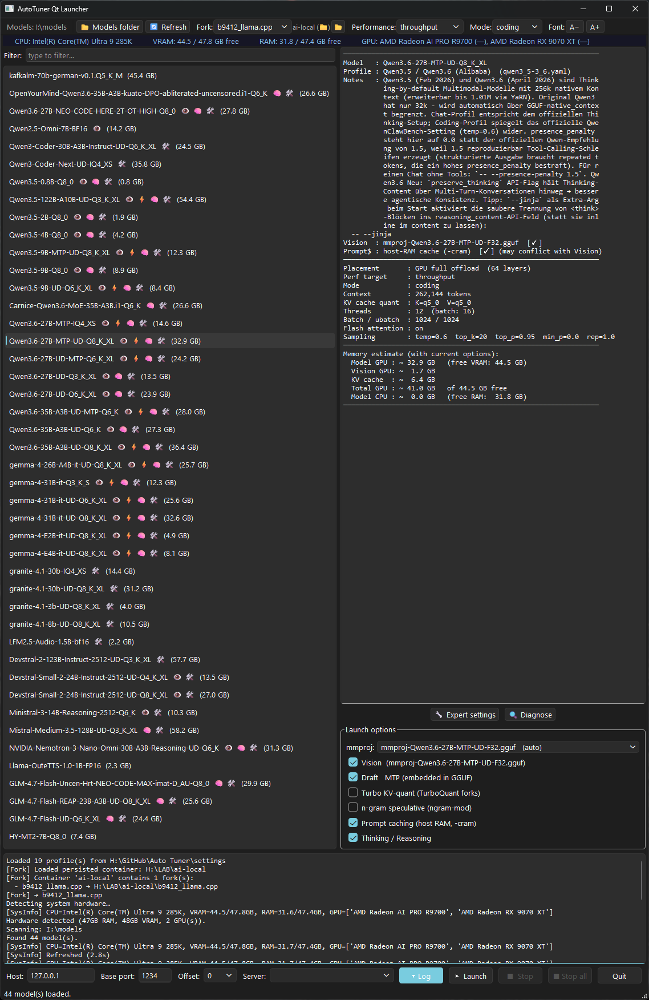

# AutoTuner for llama.cpp

Interactive launcher for `llama-server` that **detects your hardware**,
**scans your local GGUF collection**, and **auto-tunes** context length,
KV-cache quantization, GPU offload, threading, and batch size to fit in
the RAM/VRAM you actually have free — without manual edits.

# GUI-Design

GUI:


Performance Test Result:


**Live benchmark dashboard:** [See how the tested models run on the maintainer's hardware](https://dawasteh.github.io/Auto-Tuner/).

## Features

- **Interactive terminal menu** — pick from whatever GGUFs are in your
  models folder, no editing required.
- **End-to-end OCR documents (GUI + TUI)** — OCR models get a 📄 action that
  accepts images, multi-frame TIFF/GIF, PDF, Word/Office/OpenDocument,
  presentation, spreadsheet, or whole-folder input. Office files are converted
  with LibreOffice **before** the model claims RAM; PDFs are rendered with
  PyMuPDF; pages are normalized with Pillow and sent through llama-server's
  multimodal API. Per-page files, a combined Markdown/text result, and a hashed
  JSON manifest go to the selected output folder. The source documents are
  never modified.
- **Visible throughput logs** — AutoTuner emits `--perf` on current
  llama.cpp builds so the separate terminal keeps showing prompt/eval
  timings and tokens/s; append `--no-perf` if you want quieter logs.
- **Hardware auto-detection** — works on **AMD (ROCm)**, **NVIDIA**,
  **Intel**, and **Apple Silicon** (unified memory). Multi-GPU is
  supported via automatic `--tensor-split`. The split strategy depends on
  the model type:
  - **Dense** models use a **priority-weighted** split: a model that fits
    the largest card is pinned to it (the second GPU stays free for
    gaming/OBS); larger models put the bulk of the weights on the
    high-priority card.
  - **MoE** models that don't fit the primary card alone use a
    **capacity-fill** split instead — both GPUs are packed to roughly the
    same utilisation so the maximum number of expert layers stays resident
    in VRAM (every expert that lands on the GPU instead of spilling to CPU
    via `--n-cpu-moe` is a real speed win). This replaces the old
    priority-weighted behaviour for MoE, which stranded several GB on the
    secondary card and slowed the model down.

  Device visibility is derived from the selected binary's own
  `--list-devices` table. AutoTuner emits only that backend's selector
  (`HIP_VISIBLE_DEVICES` or `GGML_VK_VISIBLE_DEVICES`) when known, so HIP and
  Vulkan's different physical-device order cannot silently select the wrong GPU.
- **Free-memory aware, Q8-first KV** — Auto prefers symmetric `q8_0` for
  long-context and tool-calling quality, without spending spare memory on
  F16/BF16. Q4 is only a fallback when Q8 cannot hold the target context;
  incompatible runners/head dimensions use F16. Placement and context follow
  currently free RAM/VRAM, and manual Expert K/V pins remain authoritative.
- **Per-family YAML profiles** in `settings/` — override sampling,
  max context, chat template, and llama-server flags per model family.
  Easy for contributors to extend without touching Python. Each profile's
  `notes` explanation is shown in the configuration preview and follows the
  interface language through the language packs' `profile_notes`.
- **Companion-file auto-pairing** — sibling files don't pollute the
  model menu, they're attached to their main model:
  - `mmproj` projectors → vision (longest-prefix wins). The `mmproj`
    marker is detected **anywhere in the filename**, not just as a
    leading `mmproj-` prefix — so a projector named with the marker
    mid-name (e.g. `qwen3.6-35b-a3b-mxfp4-moe-mmproj-f16.gguf`, where the
    vendor put the quant label before `mmproj`) is now paired correctly.
    Projectors saved with a literal **`.mmproj` extension** (some audio
    projectors) are picked up too, even though they don't match the
    `*.gguf` glob. Matching is separator-tolerant (`-moe` vs `_moe` no
    longer blocks a pair) but still size-specific, so a 2B model never
    grabs a 0.8B projector. When a model ships **several projector
    precisions** side by side (`…-bf16`, `…-f16`, `…-f32`), all are kept
    as candidates and a **dropdown** in the Launch options lets you switch
    between them. The auto pick prefers the **highest precision**
    (f32 > f16 > bf16) on an otherwise-equal name match; your manual
    choice is remembered per model.
  - `*-assistant-*.gguf` / `*-draft-*.gguf` / `mtp-*.gguf` / `dspark-*.gguf`
    → speculative decoding (smallest matching sibling wins). A leading `mtp-`
    explicitly marks an external draft head even when newer Qwen-based heads
    are several GiB; large infix `…-MTP-…` target models remain normal runnable
    models. EAGLE-3, DFlash, and b10329 DSpark sidecars are also classified from
    GGUF architecture/tensor metadata and receive their required `--spec-type`.
- **Themes and appearance editor** — choose built-in System, Dark, Dark Gray, Light, High Contrast, or the pink-accented Midnight Rose theme in **⚙ Settings**, or copy one in the in-app color/font editor and save it as a safe JSON user theme. See the complete [theme guide](docs/themes.md).
- **Favorite models stay at the top** — click the star left of a model name
  to mark it. Active and inactive star colors follow the selected theme, and
  the choice is persisted across AutoTuner restarts.
- **Persistent folder tree** — folders and the Favorites section start open,
  but every branch you manually open or close keeps that exact state when you
  switch list/folder views and after restarting AutoTuner.
- **Capability badges in the model list** — symbols make it obvious
  what each model can do at a glance:
  - 👁 vision (mmproj projector paired)
  - ⚡ draft  (assistant sibling for speculative decoding)
  - 🧠 thinking (chat template emits `<think>` / `reasoning_content`)
  - 🛠 tool-use (chat template advertises `tool_calls` / `function_call`)
  - 📄 OCR/document parsing (known OCR architecture/name)

  Detection reads the GGUF chat template directly — no name-based
  guessing — so `Qwen3-Coder` (no thinking) and `Qwen3-Embedding`
  (neither thinking nor tools) are correctly excluded.
- **Model actions on right-click** — choose **GGUF-Ordner öffnen** to open the
  containing directory, or use **Expert Settings kopieren/einfügen** to transfer
  the active performance mode's complete Expert snapshot to another model. The
  internal clipboard retains the source mode (`safe`, `balanced`, `throughput`,
  or `low_vram`) so settings cannot silently land in a different mode.
- **Reads GGUF metadata** — pulls `n_layers` and `context_length`
  straight from the file so partial GPU offload (`-ngl`) is exact.
- **Author-recommended samplers from GGUF metadata** — many models embed
  their recommended sampler defaults in `general.sampling.*`
  (e.g. Qwen3.5/3.6 ship `temp 1.0 / top_k 20 / top_p 0.95`). The tuner
  now reads these and uses them to fill any sampling value a matched YAML
  profile leaves unspecified. Priority per field is: a **matched family
  profile's explicit value** wins first (these are hand-tuned), then the
  **GGUF recommendation**, then the generic default. The practical effect:
  a model with **no tailored profile** (so it would otherwise fall back to
  the generic `temp 0.7 / top_k 40`) now runs on its intended samplers —
  a frequent cause of repetition loops and broken tool-calls on models
  tuned for a low `top_k` with a non-zero `min_p`.
- **Six fast setting profiles per model and performance mode** — the top of the
  right configuration tile now switches between untouched **Auto**, benchmarked
  **Perform**, and four renameable **Custom** profiles. Perform is disabled until
  evidence exists. Editing Auto/Perform forks safely into a free Custom slot,
  so neither source is overwritten. Every non-Auto slot also stores an independent
  variant for no drafter, embedded MTP, and each external draft GGUF; switching a
  Q4/Q8/BF16/DFlash head therefore restores that head's measured `draft_n_max`,
  threads, and batch settings immediately.
- **Measured performance suite with resumable short and full searches** — select a
  normal text/chat GGUF and click **🚀 Performance test**. The default **Quick
  pass** uses at most 3.125% context, 16,384 prompt tokens, and 128 decode tokens,
  with no overall model/suite deadline; startup, HTTP, and user-cancellation
  safeguards remain active. **Standard** validates 12.5% with a 65,536 prompt cap;
  **Custom** accepts 0.01–100% uncapped. Optional **Try only
  best Settings** remeasures a conservative shortlist from stable two-sample Quick
  evidence and falls back to the full search when evidence is missing or noisy.
  A provisional Quick pass never overwrites an existing validated Standard or
  Custom Perform profile. Completed-run reuse is keyed to the exact binary
  build/file, backend/devices, frozen quality/placement, baseline, and search
  schema, so Vulkan/HIP or build changes force revalidation. All-model suites
  skip only exact matching model/mode/drafter workloads by default;
  **Rerun completed model / mode / drafter runs** opts back into them. The MTP
  option can enumerate every
  compatible external drafter/quantization as well as embedded MTP and saves each
  winner separately. Prompts are calibrated through the real `/tokenize` endpoint,
  candidates use fresh private `llama-server` processes and an excluded warm-up,
  and every completed mode/head is atomically checkpointed. **Stop after Model**
  and **Stop after Performance Mode** remain graceful resume boundaries.
- **Diagram-first graphical performance report + public benchmark page** —
  **📊 Performance report** keeps a compact in-app Quick/Standard/Custom
  comparison and writes a self-contained HTML report under
  `~/.autotuner/reports`. The redesigned dashboard starts with the captured test
  hardware, fastest result cards, aligned per-model winner charts, speculative
  acceptance, and every successful candidate diagram. The winner table, method
  text, and expandable per-run candidate/sample evidence now stay together below
  the graphics. `python publish_benchmarks.py` creates a path-redacted static
  snapshot under `benchmark-site/`; pushes to `main` deploy that snapshot to the
  [public GitHub Pages dashboard](https://dawasteh.github.io/Auto-Tuner/). See the
  [publishing guide](docs/benchmark-pages.md). Legacy fixed-25% results are
  classified as Custom; the old legacy tile is gone. The report opens with a
  **Recommended settings per model** section (fastest lane plus the exact
  winning threads/batch/ubatch/draft values), keeps the per-run candidate
  diagrams collapsed until you open them, and repeats the applied settings in
  the winner table. Standard search (18-candidate budget since v5.3.9) probes
  decoupled generation/prompt threads and a small thread count for fully
  offloaded models, checks batch families for its top two thread finalists,
  adds 2048/2048 and 4096-token micro-batch probes for large-VRAM GPUs,
  hill-climbs beyond the measured batch family while budget remains, MTP depth
  stops only after two meaningful regressions, and a
  candidate must clear 3% in every paired prompt variant before promotion. The
  fastest performance mode is remembered only when context, token mix, test tier,
  and drafter are directly comparable. Exact contexts above the static estimate are
  saved only after a real isolated inference succeeds. `low_vram` remains the safe
  explicit RAM-KV path. Settings → **Performance profiles** exports/imports the
  complete portable profile bank and drafter evidence. AutoTuner never changes
  clocks, voltage, fan curves, or power limits.
- **Faster startup and suite preparation** — model metadata headers are read by a
  bounded worker pool and cached under `~/.autotuner/cache` using path/size/mtime
  signatures, so unchanged GGUFs do not repeat the tensor-name scan after every
  restart. Model discovery now runs in parallel with hardware probing instead of
  waiting behind WMI/vendor tools. Settings JSON is parsed only when its file
  signature changes, default profile-bank reads no longer cause disk writes, and
  all-model performance preparation reuses the already-probed active runtime plus
  cached binary/drafter resolution. Model benchmarks remain sequential so VRAM,
  thermals, and measurements stay isolated.
- **Diagnostics, debug mode, and shareable reports** — **🔍 Diagnose** still shows
  the selected model's KV/MoE/hybrid analysis. It can also create a redacted
  support report for all scanned models or, after an explicit confirmation, scan
  every GGUF header into a detailed Markdown inventory in
  `~/.autotuner/reports`. Settings offers an opt-in **Debug mode** for additional
  AutoTuner discovery/config logging; it does not enable server prompt logging.
  Support reports exclude prompts, API payloads, credentials, raw settings, and
  llama-server output and redact known home/model paths.
- **Multi-server (run several models at once)** — Launch no longer
  refuses while a server is running. Each new model gets the **next free
  port**: 0 servers → `1234`, 1 → `1235`, 2 → `1236`, … When a server is
  stopped or exits, its port is reclaimed and the counter effectively
  **resets** (the next launch reuses the freed port). The status bar shows
  how many servers are live; **Stop** stops the most recent one.
- **GPU load-balancing for the 2nd/3rd model** — before launching an
  *additional* model the AutoTuner **re-reads live VRAM** (so it sees what
  the already-running models actually hold) and steers the new model onto
  the **emptier card** via `HIP_VISIBLE_DEVICES` / `GGML_VK_VISIBLE_DEVICES`.
  If **no GPU has room** it **refuses with a clear message** instead of
  piling everything onto a card that's already full (e.g. an R9700 sitting
  at 31/32 GB). The *first* model still uses the normal automatic
  multi-GPU split.
- **Host-memory prompt caching (`--cache-ram` / `-cram`)** — auto-enabled
  with a Launch-options toggle to turn it off. Cached prompt prefixes live
  in system RAM and are hot-swapped back when a new request shares a long
  prefix (system prompt, RAG scaffold, Roo-Code preamble), collapsing
  time-to-first-token on repeated prompts. Current llama.cpp builds
  (**b10045+**) support this for Vision/`mtmd` too; older or unprobeable
  builds conservatively receive `--cache-ram 0` when Vision is active.
  The default cap is **2048 MiB**, editable in the GUI or with
  `--cache-ram-mib`; the reserved amount is included in the RAM estimate.
- **Sticky GUI choices** — the Qt launcher remembers each model's selected
  **mmproj** and **draft/MTP** dropdown entries plus thinking / **n-gram** /
  **prompt-cache** toggles in `autotuner_settings.json`. n-gram self-speculation
  now defaults **on for every model**; an explicit per-model off choice remains
  authoritative. Each model also remembers its selected/fastest performance
  target and independent Expert settings for all four targets. Switch models,
  restart, or change targets — the corresponding choices return.
- **Fork-folder memory** — if you point the GUI at a parent folder
  that holds several `*_llama.cpp` builds (e.g. `C:\LAB\ai-local`),
  the next launch re-expands the same set of builds in the dropdown. Current
  backend-qualified siblings such as `b10679_vulkan_llama.cpp` and
  `b10679_hip_llama.cpp`, stable names such as `0.3.0_vulkan_llama.cpp`, and
  legacy backend-neutral folders remain recognized. Required fork switches
  preserve the selected HIP/Vulkan backend.
- **Window geometry, state & inner layout** — QMainWindow
  `saveGeometry()` (size, position, maximize-state) and `saveState()`
  (toolbars/docks) are persisted as base64 in the settings JSON. **In
  addition, each inner `QSplitter` saves its own handle positions** under
  a stable object name, so the *arrangement of the panes inside the
  window* (model-list vs config width, and the log-panel height) is
  restored too — not just the outer window size. `saveState()` alone does
  not round-trip plain central-widget splitters, hence the separate
  per-splitter persistence.
- **Global font size** — persistent font size (clamped 7..22), applied
  immediately on app start (no flash of the default).
- **Application settings & Info** — the **⚙ Settings** toolbar button and the
  Windows title-bar system menu (click the top-left app symbol) provide
  Settings plus **About AutoTuner** with the visible version and GitHub link.
  The window title also always shows the running version. Settings controls
  per-user login autostart on Windows, Linux, and macOS, plus optional **X →
  notification area/system tray** behavior. Both options are disabled by
  default; the tray menu and the dedicated **Quit** button always exit normally.
  **Start minimized after login** (below *Start after login*) opens a login
  start without a window: in the notification area when *Hide on close* is
  on, otherwise minimized on the taskbar. Until you save a choice it follows
  *Hide on close*, so enabling both login options is enough. Only the login
  entry passes `--autostart`; a manual start always shows the window, and a
  second start restores a tray-hidden AutoTuner. Entries written by older
  versions are upgraded in place on the next start when they point at the
  same installation.
- **One instance per user** — a second start of `AutoTuner.exe` (or
  `qt_launcher.py`) does not open a rival window: it brings the running
  AutoTuner to the front, also out of the notification area, and exits. The
  lock is scoped to the user and the data folder, so a portable
  `AUTOTUNER_DATA_DIR` still gets its own instance;
  `AUTOTUNER_ALLOW_MULTIPLE_INSTANCES=1` switches the guard off for development.
  Quit from the tray menu always ends the process, and a shutdown watchdog
  ends a hung teardown after 15 s so no window-less AutoTuner lingers.
- **Stable theme preview** — switching or previewing a theme preserves the
  current window and pane/splitter arrangement; responsive Appearance controls
  retain full theme/font names through sensible widths and tooltips.
- **Reasoning effort** — selectable per model: `auto` / `off` /
  `minimal` / `low` / `medium` / `high` / `extra_high`. Think-budget
  (spin-box, -1 = off, 0 = stop immediately, N = token budget) and optional
  **preserved reasoning history** (`--reasoning-preserve`) live in the
  Expert panel.

### Vision control

You can disable vision (mmproj) support in two ways:

1. **Command-line flag**:

   ```bash
   python auto_tuner.py --model "Qwen3.6" --novision
   ```

2. **GUI checkbox** in *Launch options*. A second checkbox can keep an
   active projector in system RAM (`--no-mmproj-offload`); the memory preview
   then moves its footprint from VRAM to RAM. When the model ships several
   projector precisions (`…-bf16` / `…-f16` / `…-f32`), an **mmproj
   dropdown** appears above the checkboxes so you can pick which one to
   load. The chosen projector is remembered per model in
   `autotuner_settings.json` under `mmproj_selection`. The auto pick
   defaults to the highest precision available.

> **Note on prompt caching + vision:** llama.cpp **b10045+** can cache
> multimodal prompts. AutoTuner enables it on those builds; older or
> unprobeable binaries safely fall back to `--cache-ram 0` while Vision is
> active. This was runtime-verified on b10058 with a repeated Gemma 4 image
> request (`cached_tokens`: 0 → 279).

### OCR documents

The shared GUI/TUI presets use the publishers' task prompts: GLM-OCR
`Text Recognition:`, PaddleOCR-VL `OCR:`, and dots.ocr
`Extract the text content from this image.` You can still override the prompt.

Select an OCR model with its matching mmproj (for example
`Unlimited-OCR-BF16.gguf` + `mmproj-Unlimited-OCR-F16.gguf`). In the Qt GUI,
click **📄 OCR…** or double-click the OCR model. Choose one or more files/folders,
an output folder, PDF page range, DPI, output format, and token budget. The GUI
converts/prepares documents first, loads the model, verifies the server's model
alias, shows page progress, and optionally releases the server/VRAM afterward.

Terminal equivalent:

```bash
python auto_tuner.py \
  --model "Unlimited-OCR" \
  --ocr-input document.pdf \
  --ocr-input scans/ \
  --ocr-output ocr-results \
  --ocr-pages 1-5 \
  --ocr-dpi 220 \
  --ocr-max-tokens 4096 \
  --non-interactive --yes
```

PDF rendering requires PyMuPDF and image normalization requires Pillow (both are
installed by `requirements.txt`). Word/Office/OpenDocument input additionally
requires a local LibreOffice installation; without it AutoTuner gives a clear
error and leaves the source untouched. Unlimited-OCR uses its verified
`document parsing.` prompt, compatible F16 KV with Flash Attention off,
deterministic sampling, and requires llama.cpp b10287+ (b10839 is audited). **There is no CMake/build flag for `max_tiles=32`.** The value
comes from the projector GGUF metadata. For the full 32-tile Unlimited-OCR
path, the mmproj must contain `clip.vision.preproc_max_tiles=32`; AutoTuner
warns when an older projector would silently fall back to 9 tiles. Reconvert
Unlimited-OCR's mmproj with a current `convert_hf_to_gguf.py --mmproj` (the
current converter writes 32 automatically), or download a newly converted
projector. Rebuilding `llama-server` cannot repair an old mmproj.

AutoTuner's OCR workflow uses the persistent OpenAI-compatible HTTP server, not
`llama-mtmd-cli`. Therefore a llama.cpp directory is shown in the fork picker
only after it contains `build/bin/Release/llama-server.exe` (or the native
Linux/macOS binary). `building llama.cpp/ocr_vulkan_llama_build.ps1` and
`ocr_hip_llama_build.ps1` build both `llama-server` and `llama-mtmd-cli` from
the exact reviewed legacy PR #17400 commit; that old fork remains for
DeepSeek-OCR v1. Unlimited-OCR should use either current mainline recipe,
`llama_prerelease_vulkan_build.ps1` or `llama_prerelease_hip_build.ps1`.

## Installation

```bash
git clone https://github.com/DaWasteh/Auto-Tuner.git
cd "Auto-Tuner"
pip install -r requirements.txt
```

You also need a working `llama-server` binary. The tuner automatically discovers binaries in common local setups (like `C:\LAB\ai-local\`), or you can specify one via `--server`.

## Update (GUI-Button oder Terminal)

In der Qt-GUI gibt es oben in der Toolbar den Button **⬆ Update**. Die laufende
Version steht im Fenstertitel sowie in den Update-Dialogen und -Meldungen. In einem
Source-Start prüft er den Git-Branch beziehungsweise das GitHub-Source-ZIP, nicht
Release-Assets. In einem echten `git clone` nutzt
er `git pull --ff-only`; in einem heruntergeladenen ZIP/Release-Ordner ohne
`.git` lädt er automatisch das aktuelle GitHub-Source-ZIP herunter und spielt
es über die bestehende Installation. Bei geänderter `requirements.txt` führt
er automatisch `pip install -r requirements.txt` aus. Vor dem Update wird
`autotuner_settings.json` gesichert und danach wiederhergestellt — deine
lokalen Pfade, Ports, Overrides und UI-Einstellungen werden also nicht
überschrieben (auch bei älteren Klonen, in denen die Datei noch versehentlich
von Git getrackt wird). Nach einem erfolgreichen Update AutoTuner neu starten.

Danke für die Update-Button-Idee an [nextscript](https://github.com/nextscript).

Wenn du AutoTuner per `git clone` installiert hast, kannst du neue Versionen
weiterhin über das Terminal holen. Deine persönlichen Einstellungen bleiben
auch dabei erhalten: Python-Start und kompilierte App verwenden gemeinsam
`~/.autotuner/autotuner_settings.json`.

**1. In den App-Ordner wechseln** (dorthin, wo du geklont hast):

```bash
cd "H:/GitHub/Auto Tuner"
```

**2. Aktuelle Änderungen herunterladen:**

```bash
git pull
```
Falls du lokal an den Python-Dateien herumgepfuscht hast und `git pull`
mit einem Konflikt abbricht, kannst du deine lokalen Änderungen
verwerfen und den Upstream-Stand übernehmen:

```bash
git stash            # lokale Änderungen kurz beiseite legen
git pull
git stash drop       # beiseite gelegte Änderungen verwerfen
# oder: git stash pop  → Änderungen wiederherstellen (evtl. Konflikte lösen)
```

> ⚠️ In aktuellen Klonen ist `autotuner_settings.json` gitignored; `git stash`
> berührt sie dann nicht. Wenn dein alter Klon die Datei noch als geändert
> anzeigt, nutze bevorzugt den **⬆ Update**-Button — er sichert und restored
> die Datei explizit.

**3. Abhängigkeiten aktualisieren** (nur nötig, wenn sich `requirements.txt`
geändert hat — schadet aber nie):

```bash
pip install -r requirements.txt
```
Falls du eine virtuelle Umgebung nutzt, aktiviere sie vorher. Projekt-Konvention:
Windows nutzt `.venv`, Ubuntu/Linux nutzt `.venv_linux`.

```bash
# Ubuntu/Linux
python3 -m venv .venv_linux
.venv_linux/bin/python -m pip install -r requirements.txt
source .venv_linux/bin/activate
```

```bat
REM Windows
py -m venv .venv
.venv\Scripts\activate
pip install -r requirements.txt
```

**4. App starten** — danach einfach wie gewohnt:

```bash
python qt_launcher.py        # GUI
# oder
python auto_tuner.py         # Terminal
```

**Kurzform** (wenn sich nichts an den Abhängigkeiten geändert hat):

```bash
git pull && python qt_launcher.py
```

## Compiled build (.exe / Linux binary)

Für Einsteiger gibt es kompilierte **noconsole**-Versionen ohne separate
Python-Installation: **Windows 10/11 x64** (`.exe`), **Linux x64** und
**macOS Apple Silicon arm64**. Der Linux-Build wird bei jedem Release
automatisiert auf **Ubuntu, Fedora, Arch Linux, Linux Mint, CachyOS, Kali
Linux und Debian** gestartet; Windows und macOS erhalten zusätzlich einen
nativen Frozen-Binary-Smoke-Test. Alle drei Builds verwenden denselben
**⬆ Update**-Button.

Der macOS-Build ist derzeit nicht mit einer kostenpflichtigen Apple Developer
ID signiert/notarisiert. Gatekeeper kann deshalb beim ersten Start warnen:
App im Finder mit **Rechtsklick → Öffnen** starten und die Rückfrage bestätigen;
falls nötig unter **Systemeinstellungen → Datenschutz & Sicherheit → Dennoch
öffnen** freigeben. Nur das Asset aus dem offiziellen AutoTuner-GitHub-Release
verwenden. Intel-Macs und ARM-Linux sind derzeit Source-Installationen, keine
bereitgestellten Frozen-Assets.

### Bauen

PyInstaller kann nicht cross-kompilieren — die `.exe` wird **auf Windows**,
der Linux-Binary **auf Linux** und der macOS-Build **auf macOS** erzeugt. Alle
landen als Assets im selben GitHub-Release. GitHub Actions prüft den Quellcode
zusätzlich in nativen Containern der oben genannten Linux-Distributionen.

```bash
# einmalig im Build-Environment:
python -m pip install pyinstaller
python -m pip install -r requirements.txt

# dann das jeweilige Binary bauen:
python build_exe.py
# → Windows: dist/AutoTuner.exe   |   Linux: dist/AutoTuner-Linux
```

`build_exe.py` bündelt `settings/*.yaml` und das App-Icon aus `assets/` als
read-only Daten mit; unter Windows wird `assets/AutoTuner.ico` zusätzlich in
die `.exe` eingebettet. Python- und Frozen-Starts teilen Einstellungen,
Benchmarkdaten, Themes, Reports und Logs unter `~/.autotuner` (Windows z. B.
`C:\Users\Name\.autotuner`). Beim ersten v5.2.8-Start werden ältere Dateien
aus Source- und EXE-Ordnern zusammengeführt und unverändert gesichert.

### Release / Auto-Update

1. `autotuner_version.py` → `VERSION` hochzählen (z. B. `"1.1.0"`).
2. Commit + Tag **`v1.1.0`** (das Tag-Format `v<VERSION>` ist Pflicht — der
   Updater streift das führende `v` vor dem Vergleich).
3. Der Release-Workflow erstellt die drei ZIP-Assets für Windows, Linux und
   macOS. Veröffentlicht wird erst, nachdem das Linux-Binary die Smoke-Tests
   auf allen unterstützten Distributionen bestanden hat.
4. Der Update-Button in der kompilierten Version holt sich automatisch das
   zum laufenden OS passende Asset, lädt es herunter und tauscht das Binary
   über einen Swap-Shim nach Neustart aus (Windows sperrt die laufende `.exe`,
   deshalb der Shim; auf Linux geht das direkte `mv` über das laufende ELF).

> Source-Installationen (Entwickler) nutzen weiterhin den git/ZIP-Updater; die
> kompilierte Version wählt automatisch den Binary-Swap-Pfad (`sys.frozen`).

## Usage

Point it at a folder of `*.gguf` models — it will recurse:

```bash
python auto_tuner.py --models-path /path/to/models
```

Or set the environment variable once:

```bash
export AUTOTUNER_MODELS=/path/to/models     # Linux / macOS
setx  AUTOTUNER_MODELS  D:\models           # Windows
python auto_tuner.py
```

Pick a model from the menu. Once it's running, point your client at:

```
http://127.0.0.1:1234
```

Works with the built-in **llama.cpp Web UI**, **VS Code** extensions
like Continue / Cline, **Open WebUI**, or any OpenAI-API client.

### Terminal TUI

```bash
python auto_tuner.py
```

The dependency-free terminal interface is designed for enthusiasts who prefer a
fast keyboard workflow. It shows the shared **AutoTuner version**, responsive
model cards, capability badges, the active performance target/GPU pin, and a
compact memory/config summary. ANSI color is used only in compatible TTYs;
logs, pipes, and `--plain` automatically use an ASCII-only, ANSI-free view.

For repeatable scripts, use an unambiguous model with `--non-interactive` (or
`--dry-run` / `--yes`). These paths do not read prompts: available vision,
draft, thinking, and n-gram features use their normal defaults. n-gram is on by
default for every model; use `--no-ngram` to disable it (`--ngram` remains a
compatible explicit-on spelling). The terminal UI shares the launch engine, but the GUI
remains the place for persisted per-model Expert controls; advanced
llama-server options can still be passed after `--`. OCR models expose the same
shared document pipeline through `--ocr-input` / `--ocr-output`; the job-owned
server is stopped automatically when processing finishes.

### Qt GUI

```bash
python qt_launcher.py
```

Same engine as the terminal launcher, plus a few quality-of-life bits
that only make sense with persistent state:

- **Compact, persistent secondary toolbar and live languages.** Fonts, Update,
  and Settings now stay under **⋯**, leaving the primary model/runtime row
  wider. The second row remains open until **⋯** is clicked again. Its language
  selector includes English (UK), German, Dutch, Swedish, Japanese, French,
  Greek, Polish, and Russian. Every hover explanation ("In short" / "Technical
  details"), dialog, Expert label, and model-row tooltip follows the selected
  language live. Validated custom JSON packs live under
  `~/.autotuner/languages`, fall back to English for missing strings, and can be
  created from the generated template described in
  [`docs/languages.md`](docs/languages.md).
- **Opt-in local model-control API.** Settings can start a bearer-authenticated,
  loopback-only OpenAI endpoint that lists the live AutoTuner catalogue and
  atomically switches to a requested model with its saved launch settings. It
  stops only the prior API-managed server, waits for `/health`, and preserves
  SSE streaming through the proxy. The dynamic Pi provider is in
  [`integrations/pi/autotuner.ts`](integrations/pi/autotuner.ts); endpoint and
  security details are in [`docs/control-api.md`](docs/control-api.md).
- **OCR dialog and progress.** OCR models show **📄 OCR…**; double-clicking one
  opens the same workflow as the TUI. Inputs are prepared off the GUI thread,
  mutable launch controls are locked until the validated server starts, Cancel
  interrupts LibreOffice/HTTP/model loading, and successful output can be opened
  directly from the completion dialog.
- **Sticky per-model options.** Choose mmproj and draft/MTP directly from
  their dropdowns (`none` disables either feature), then toggle thinking /
  n-gram / prompt-cache as needed. n-gram starts on but can be disabled per
  model. Choices survive model switches and restarts.
- **Expert settings are saved per model *and performance target* (autosave).**
  Auto-cascade pins and full Manual setups are independently persisted for
  `safe`, `balanced`, `throughput`, and `low_vram`; changing the toolbar target
  restores that target's values instead of leaking one winner into every mode.
  Auto-mode saves re-cascade against current hardware. A context proven by the
  isolated real benchmark is stored as an exact Manual profile so a later static
  estimate cannot silently clamp it. **⟲ Reset** resets only the current mode.
  Settings → **Performance profiles** exports/imports these snapshots and their
  measurement evidence without copying unrelated application settings.
- **Run several models at once.** Launch stays enabled while servers are
  running — each new model is placed on the **emptier GPU** and given the
  **next free port** (1234, 1235, 1236, …). Stop a server and its port is
  freed for the next launch. If no card has room, the GUI tells you
  instead of overcommitting a full GPU.
- **GPU pin dropdown (toolbar → *GPU*).** Click-path equivalent of the
  CLI `--gpu` flag: choose **Auto** for the usual free-VRAM-aware
  selection, or pick a card by name to **hard-pin** the next launch to it
  and hide the others. The card list is filled from detected hardware, so
  it shows your actual GPUs (e.g. *R9700*, *9070*) rather than fixed
  labels. Use it to force a second server onto the still-empty card
  instead of letting it pile onto the busy one. The choice is persisted as
  `forced_gpu` in `autotuner_settings.json` and feeds the same
  `compute_config(force_gpu=…)` path as the CLI flag, so the config
  preview updates the instant you change it.
- **Fork picker remembers the parent folder.** Hit *📂 Fork* and
  pick a directory that holds multiple `*_llama.cpp` builds — every
  build appears in the dropdown next time too, not just the last one
  you used. The active build within that container is also restored.
- **Live config preview.** The right pane recomputes
  context / KV / placement whenever you tick a checkbox or change the
  performance target — no need to launch first.
- **Honest load status (`/health` handshake).** After launch the status
  bar shows *Loading model* and only flips to *Ready* once the server's
  `GET /health` returns 200. Big MoE models can take a while to load (or
  fail mid graph-build) — the GUI no longer claims "Running" the instant
  the PID exists. A crash during load is surfaced as *Server exited*.
- **Window geometry + inner layout persistence.** Window size, position,
  maximize-state and toolbar status are saved, **and** the inner pane
  arrangement (model-list vs config width, log-panel height) is restored
  via each splitter's own `saveState()` — not just the outer window.
- **Font persistence.** The global QApplication font size is persisted
  and applied immediately on start (`_change_font`). No more flash of the
  default font size.
- **Reasoning panel (Expert panel).** New section with:
  - Dropdown "Effort": `auto` / `off` / `minimal` / `low` /
      `medium` / `high` / `extra_high`
  - SpinBox "Think budget": `-1` = off, `0` = stop immediately, `N` =
      token budget
  - Checkbox "Preserve reasoning history" → `--reasoning-preserve`
  The values are translated into `--reasoning`, `--reasoning-budget`,
  `--chat-template-kwargs` and `--reasoning-preserve` in
  `cfg.extra_cli_flags`.

### Useful flags

| Flag | Description |
|---|---|
| `--models-path PATH` | Folder to scan (default `./models`, env `AUTOTUNER_MODELS`) |
| `--settings-path PATH` | Folder with YAML profiles (default `./settings`) |
| `--server PATH` | Path to `llama-server` (default looks on `$PATH`, env `LLAMA_SERVER`) |
| `--host HOST` | Bind address (default `127.0.0.1`) |
| `--port N` | Server port (default `1234`). In the GUI this is the **base** port; each additional concurrent server gets the next free one (1235, 1236, …) |
| `--ctx N` | Override the auto-tuned context length |
| `--model SUBSTR` | Skip the menu, pick a model by name substring |
| `--gpu NAME` | Hard-pin the server to a single GPU by name substring (e.g. `--gpu 9070`, `--gpu R9700`). Overrides the persisted `forced_gpu`; omit for free-VRAM-aware auto selection. The GUI exposes the same pin via the toolbar **GPU** dropdown |
| `--ngram` / `--no-ngram` | Explicitly enable / disable default-on n-gram self-speculative decoding |
| `--no-mmproj-offload` | Keep an active vision projector in system RAM instead of VRAM; its size is moved into the RAM budget |
| `--cache-ram-mib MIB` | Bound host prompt caching (`-1` unlimited, `0` disabled); without this flag the saved GUI cache limit is used |
| `--no-prompt-cache` | Disable host-memory prompt caching (`--cache-ram 0`). Caching is auto-on; Vision requires llama.cpp b10045+ and falls back to off on older/unprobeable builds |
| `--ocr-input PATH` | Run OCR for a file or recursively for a folder; repeat for several inputs |
| `--ocr-output DIR` | Parent folder for the timestamped OCR job/results |
| `--ocr-pages RANGE` | PDF/multi-frame page selection such as `1-3,5` (default all) |
| `--ocr-dpi N` | PDF render DPI, safely clamped to 72–600 (default 220) |
| `--ocr-max-tokens N` | Maximum generated tokens per page (default 4096) |
| `--ocr-format {markdown,text}` | Per-page and combined output format |
| `--ocr-keep-rendered` | Keep normalized/rendered PNG pages for inspection |
| `--ocr-keep-grounding` | Preserve OCR bounding-box/grounding markup instead of cleaning it |
| `--dry-run` | Print the command and OCR plan, don't start the server; never opens TUI prompts when used with `--model` |
| `--yes / -y` | Skip the launch confirmation prompt and use non-interactive defaults with `--model` |
| `--non-interactive` | Require `--model` and never read prompts; intended for scripts/CI |
| `--mode {chat,coding}` | Select profile sampling mode (default: saved GUI preference or `chat`) |
| `--plain`, `--no-color` | Use ASCII-only output, or retain Unicode while disabling ANSI color |
| `--debug`, `--debug-category NAME` | Enable all debug output or one of `hardware`, `scanner`, `llama_cpp`, `config` |
| `--force-mlock` | Force the non-mmap locking path when resources/OS permissions allow it (Expert GUI exposes all `--load-mode` choices) |
| `--performance-target {safe,balanced,throughput,low_vram}` | VRAM utilisation preset (see below) |
| `-- <args...>` | Anything after `--` is forwarded to `llama-server` |

### Performance targets (`--performance-target`)

A single switch that controls how aggressively the AutoTuner reserves
VRAM. It changes both the safety bands and the KV-cache budget that
gets reserved up front during MoE layer placement, so picking the right
tier can move several expert layers between GPU and CPU.

| Tier | KV reservation (MoE / dense) | VRAM safety | When to use |
|---|---|---|---|
| `safe` | 128 k / 64 k tokens | 0.30 GB | Long-context sessions (>64 k), maximum stability |
| `balanced` *(default)* | 64 k / 32 k tokens | 0.25 GB | General use — moderate optimisation that helps everyone |
| `throughput` | 32 k / 16 k tokens | 0.15 GB | Short-context inference (chat, reasoning ≤32 k); pushes more expert layers onto the GPU for higher tokens/s |
| `low_vram` | KV → system RAM | 0.15 GB | **Dedicated low-VRAM / high-RAM boxes** (e.g. 8 GB VRAM, 64 GB RAM). Emits `--no-kv-offload`; attention follows the KV to the CPU. On Apple/iGPU unified memory this changes compute placement but does not increase physical capacity. |

#### Why `low_vram` exists

On a GPU too small to hold both a MoE model's expert weights **and**
its KV cache, the leftover VRAM after expert placement throttles context
to a few thousand tokens — useless for agentic coding, which typically
needs 90–130 k. The other tiers keep the MoE KV cache in VRAM (the
Vulkan backend asserts when MoE KV spills to RAM mid-split), so they
cannot help here. `low_vram` sidesteps the whole problem by telling
llama.cpp to keep the **entire** KV cache in system RAM
(`--no-kv-offload`); the model's 64 GB of RAM becomes the context
budget instead of the ~1 GB of leftover VRAM. Experts still run on the
GPU where they fit (`--n-cpu-moe`), so only attention is paid for in
speed. Opt-in only — `safe`/`balanced`/`throughput` are completely
unaffected.

`low_vram` trades VRAM for **system RAM**; it cannot help a machine that is
short of both. When the estimated KV/compute budget cannot hold even the
2,048-token minimum, every tier now refuses the plan and says why (GUI
preview and launch dialog, control-API launch error, CLI exit code 2)
instead of presenting a 2k context that could not allocate.

#### Small Windows systems: adaptive low-memory Auto

On Windows with **one discrete Vulkan GPU of at most 12 GiB and at most
32 GiB RAM**, a single-file MoE model that does not fit the free VRAM gets a
bounded plan that was validated on a real RX Vega 8 GiB / 16 GiB RAM machine
([issue #6](https://github.com/DaWasteh/Auto-Tuner/issues/6)):

- `--n-cpu-moe` is chosen from the exact per-block expert sizes in the GGUF
  tensor table (the prefix llama.cpp really moves), input embeddings are
  counted in RAM, and a tied output embedding stays on the CPU
  (`-ngl <blocks>`) instead of loading a second copy on the GPU.
- 256/128 batches, `--load-mode none`, `--no-op-offload` and a 0.5 GiB host
  runtime reserve keep Vulkan staging from pushing RAM over the edge.
- Optional features are dropped in order — host prompt cache, then
  drafting, then vision — and the plan with the largest context wins (ties
  keep more features). Every dropped feature is named in the warning,
  preview and launch log; your saved options are not changed.

Everything else — multi-GPU, Linux, larger systems, split GGUFs, UMA — keeps
the existing planner. `inspect_context_capacity.py` prints a read-only
capacity estimate and `verify_auto_matrix.py` repeats the reporter's
sequential real-runtime check.

**Resolution priority** (highest wins): explicit CLI flag → GUI dropdown
→ `performance_target:` in the model's YAML profile → `balanced` default.
Unknown values are silently ignored, so a typo in a YAML never breaks
anything.

A profile can declare its preferred tier in YAML:

```yaml
# settings/qwen3_5-3_6.yaml
performance_target: throughput   # MoE — wants every spare GB on the GPU
```

The user choice (CLI / GUI) always wins over the profile recommendation.

### Model loading and memory locking (`--load-mode`)

The Expert panel exposes llama.cpp's complete model-loading strategy: `auto`
(upstream policy; b10364 avoids mmap on iGPUs), `none`, `mmap`, `mlock`,
`mmap+mlock`, and `dio`. Starting with
**b10151**, `mlock` means lock normally-read model memory **without mmap**, while
`mmap+mlock` explicitly combines mapping and locking. AutoTuner emits the
non-deprecated `--load-mode MODE` form and migrates old per-model
`mlock`/`no_mmap` checkbox snapshots automatically. **b10875 removed**
`--mmap`, `--no-mmap`, `--mlock`, `--direct-io`/`-dio` and
`--no-direct-io`/`-ndio` from the parser—not just their warning text.
Old free-form switches are migrated; an explicit dropdown choice remains
binding. Request locking through the dropdown or `--force-mlock`, not Extras:
free-form locking now fails visibly rather than bypassing RAM/OS safety checks.

Since **v5.6.1** a plan that keeps *all* weights on the GPU defaults to
`none` on Windows: with mmap the whole model file stayed in the server's
working set after the upload (16 GiB of RAM in use for a model that lives in
VRAM), while plain reads load slightly faster and leave only the real host
footprint. Hybrid plans, lazy row tables, Linux/macOS and any explicit
dropdown choice keep their previous mode. The memory estimate also lists
llama.cpp's compute buffers (`Compute GPU` / `Compute RAM`); see the
[measurement](docs/v5.6.1-validation.md#memory-estimate-audit).

For giant lazy row tables AutoTuner explicitly uses **`--lazy-mode on`**:
b10867's `auto` can disable lazy loading on devices without mmap support.
`on` preserves the active-row memory plan, potentially at an iGPU performance
cost; it is **not a hard resident-memory limit**. Older saved `auto` Extras
are migrated to this explicit contract. Ordinary model-load mode is separate.

The automatic tuner still enables locking only when available RAM/VRAM and OS
permissions make it safe. Old or unprobeable GPU builds retain the conservative
Vulkan host-buffer crash guard; versioned b10151+ builds allow the Expert
locking choices.

**Automatic behavior:**

| Scenario | Condition | Result |
|---|---|---|
| **GPU backend present** | Any detected GPU; automatic config has no resolved binary yet | Locking stays off conservatively; Expert mode permits it after verifying b10151+ |
| **CPU-only model** | `total_ram > 32 GB` AND `free_ram > model_ram_on_cpu + 8 GB` | non-mmap `mlock` selected when OS permissions allow it; on b10107–b10150 binaries non-mmap locking is unavailable and silently drops to mmap |
| **Insufficient memory** | Safety reserve not met | Locking disabled; runtime/device automatic load policy |

**Force memory locking:**

Use `--force-mlock` to override the automatic decision and always enable
memory locking when the OS permits it:

```bash
python auto_tuner.py --force-mlock
```

This is useful when you know your system has enough memory but the tuner's
conservative thresholds would otherwise skip it.

**Debug output:**

The tuner prints the mlock decision before every launch:

```
  [mlock] decision: model=Qwen3.6-35B-A3B-UD-Q6_K
         full_offload=True  vram=18.5GB  ram=0.0GB
         sys: total_vram=24.0GB  free_vram=5.2GB  total_ram=32.0GB  free_ram=12.1GB
         force_mlock=False  -> mlock=True  no_mmap=True
```

### Environment variables

| Variable | Default | Purpose |
|---|---|---|
| `AUTOTUNER_MODELS` | `./models` | Where to scan for `*.gguf` files |
| `LLAMA_SERVER` | `llama-server` | Path or name of the server binary |
| `LLAMA_CPP_DIR` | (auto-detected) | Your llama.cpp checkout. If set, the auto-tuner will look for `build/bin/[Release/]llama-server[.exe]` inside it. |
| `AUTOTUNER_DATA_DIR` | `~/.autotuner` | Portable override of the user-data folder (settings, logs, caches). Each data folder also has its own single-instance lock. |
| `AUTOTUNER_ALLOW_MULTIPLE_INSTANCES` | unset | Set to `1` to allow several GUI instances for the same user and data folder (development only). |

### Server binary auto-discovery

The tuner automatically searches for binaries in common local layouts.
If you have a workspace like this, it "Just Works" without any flags:

```
L:\GitHub\
└── Auto Tuner\         ← clone of this repo
L:\LAB\
└── ai-local\
    ├── llama.cpp\      ← standard build
    ├── tq_llama.cpp\   ← Turbo-Quant build
    ├── ik_llama.cpp\   ← Gemma 4 external drafter (fork still needed)
    └── 2b_b10743_vulkan_llama.cpp\   ← PrismML prism fork (Ternary-Bonsai, Ternary-Bonsai 2)
I:\
└── models\             ← your models
```

It looks for `llama-server` inside these directories (including `build/bin/...` subpaths).

#### Quantization Modes

When you start the tuner, you can choose between:

1. **Standard-Quant**: Uses standard `llama.cpp` binaries.
2. **Turbo-Quant**: Uses the `tq_llama.cpp` binary for faster inference.

#### KV precision and TurboQuant options

Since v5.4.3 Auto reserves for symmetric **Q8_0** K/V: the intended balance
of long-context/tool-calling quality and memory, not a step toward F16/BF16.
Spare memory never triggers an unquantised upgrade. If Q8 cannot hold the
requested/native context in the usable **per-slot** budget, Auto falls back
to symmetric Q4 and explains why. Lowering the context or explicitly pinning
Q8 avoids that quality trade-off. A peer GPU may be used to preserve Q8 at the
target context; peers with no usable memory remain excluded.

Explicit K/V pins remain authoritative and their actual precision is included
in placement. Automatic pairs stay symmetric for default CUDA/MLA compatibility.
Flash Attention off (including Grok) and known head dimensions incompatible
with quantisation use F16 as a compatibility exception. Changing Flash Attention
now recomputes KV and memory rather than applying an unsafe late flag overlay.
DiffusionGemma retains its forced-F16 runner contract; mainline diffusion-cli
now receives the planned `-ctk`, `-ctv`, and `-fa` values. Existing manual profiles
are not rewritten. Older measured Q4/F16 winners remain historical evidence but
must be benchmarked again before automatic reuse with the new search policy.

The Expert K/V dropdowns expose the mainline types `f16`, `bf16`, `q8_0`,
`q5_0`, `q5_1`, `q4_0`, `q4_1`, and `iq4_nl`, plus fork-only `turbo2`,
`turbo3`, and `turbo4`. Turbo KV is no longer duplicated as a Launch options
checkbox. Selecting a TurboQuant type shows a special-fork warning with
**Dismiss** and **Never Show Again**; current mainline llama.cpp rejects those
types.

`kv_quant_factor()` also understands `tq3_0`, `turbo3_tcq`, and the normal to
Turbo mapping used by compatible terminal/fork flows:

| Label   | Turbo-Quant | Factor (vs F16) |
|---------|-------------|-----------------|
| `q8_0`  | `turbo4`    | ~3.8x           |
| `q5_0`  | `turbo3`    | ~4.3x           |
| `q4_0`  | `turbo3`    | ~4.3x           |

#### Specialized Binary Logic

The tuner intelligently selects the best binary based on your model and settings:

- **Gemma 4 (with or without draft)** $\rightarrow$ uses the selected `llama.cpp` build. Mainline runs the `gemma4-assistant` MTP head (`--spec-type draft-mtp`) and sibling drafters natively since b9190 (PR #23398); only a build too old to advertise `--spec-type` still falls back to a legacy `ik_llama.cpp` tree if one is installed.
- **Integrated MTP (e.g. Qwen3.6-27B-MTP)** $\rightarrow$ uses standard `llama.cpp` (native since b9190+; PR #22673 in mainline since 16 May 2026; no fork needed).
- **Ternary-Bonsai / Ternary-Bonsai 2** $\rightarrow$ uses the PrismML prism fork
  (`2b_bNNNN_{vulkan,hip}_llama.cpp`) for the `PTQ1_0` / `PQ2_0` packings: mainline
  llama.cpp (still b12187) rejects them as unknown ggml types 143 / 142. Since
  b11556 (PR #29600) mainline loads the Hadamard fold (`prism.hadamard.*`) for
  mainline conversions (`Q2_0`, `F16`; e.g. Ternary-Bonsai-2 2B/4B/9B `Q2_0`).
  AutoTuner therefore checks two loader strings in the selected runtime: the
  `prism.hadamard` loader, and for the private types also the fork's own
  `PTQ1_0` / `PQ2_0` file-type names. Without that second check b11669 and later
  would accept the PrismML `PTQ1_0` / `PQ2_0` GGUFs and fail while loading.
- **Agnes-3.0-Flash Preview, kingjones777 `MTP-ROCmFP4` / `ROCmFPX` GGUFs** $\rightarrow$
  need the ROCmFPX fork (`github.com/ROCmFPX/ROCmFPX`, legacy
  `charlie12345/ROCmFPX`). Their weights use the fork's reserved ggml types
  100–111 (`Q4_0_ROCMFP4` = 100, `Q8_0_ROCMFPX` = 103; file types 100–124, e.g.
  106 = *ROCmFP4 Strix Lean*), which mainline llama.cpp (still b12187) rejects as
  `invalid ggml type 100. should be in [0, 44)`; the CPU-only upstream PR #24185
  is still open. AutoTuner records the tensor types during the header scan
  and refuses such a GGUF before launch on a runtime whose llama library has
  no `ROCmFP` loader string. Agnes itself is a folded `qwen35` conversion: the
  standard quants (0xKitkat, ngquocvinh) load on mainline, while the
  `ffn_*_par` conversions (jakeatx, quimmedes) need their own forks. The pinned
  recipes `rocmfpx_{vulkan,hip}_llama_build.ps1` produce
  `fpx_b11544_{vulkan,hip}_llama.cpp`; measured 2026-09-19: STRIX_LEAN decodes
  about 67 tok/s on HIP (R9700) and 29 tok/s on Vulkan with the in-file MTP
  head, COHERENT matches on HIP but drops to 5 tok/s on Vulkan, and image
  requests work with the MTP head loaded on both backends.
- **EschaLabs W2 GGUFs (e.g. `Escha-Qwen3.8-27B-W2`, `-Q8E`)** $\rightarrow$ need the
  Escha fork of llama.cpp (`github.com/Ajay9o9/llama.cpp-escha`, branch
  `escha-w2-dense` for the dense 27B, `escha-w2` for the 35B-A3B MoE). Their
  native 2/3-bit Escha code (`escha_lut` codec table, `escha_code` weight
  tensors, `<arch>.escha.version`) has no mainline loader: b11538 stops with
  `check_tensor_dims: tensor 'blk.0.ssm_out.weight' not found`, so AutoTuner
  refuses the model before launch unless the selected runtime's llama library
  carries the Escha loader. On that fork the separate MTP head
  (`Escha-Qwen3.8-27B-W2-MTP-F16-headQ4.gguf`, with or without an `mtp-`
  prefix) is paired automatically and starts with `-md` +
  `--spec-type draft-mtp`: the fork's MTP-only loader makes `token_embd` /
  `output_norm` optional and the head carries no codec of its own. The fork's
  GPU kernels are CUDA; AutoTuner has not validated it on AMD hardware.
- **Turbo-Quant Mode** $\rightarrow$ uses `tq_llama.cpp`.

Example — run Devstral, override context, and pass an extra flag
(`--metrics` is enabled by default, so this just shows pass-through):

```bash
python auto_tuner.py --model Devstral --ctx 131072 -y -- --verbose
```

## Adding profiles for new models

Drop a new YAML file into `settings/`. The filename doesn't matter;
the `patterns:` list does. The longest pattern that appears as a
substring of the model filename wins.

```yaml
# settings/my-model.yaml
display_name: "My Model"
patterns:
  - my-model
  - my-model-base

max_context: 131072
recommended_kv_quant: q8_0

sampling:
  temperature: 0.7
  top_k: 40
  top_p: 0.9
  min_p: 0.05
  repeat_penalty: 1.05

# Optional:
chat_template: chatml
extra_args:
  - --no-context-shift
notes: >
  Anything you want to remind yourself about this model.
```

`recommended_kv_quant` is retained for profile compatibility/documentation;
from v5.4.3 normal Auto mode deliberately prefers Q8_0. Manual Expert
K/V selections are the supported way to override that global default.

Profiles with empty `patterns:` become the fallback when nothing else
matches. See `settings/_default.yaml`.

**Profiles currently bundled** (arch string read from GGUF metadata):

| Profile file | Models | llama.cpp arch |
|--------------|--------|----------------|
| `gemma-3.yaml` / `gemma-3n.yaml` | Gemma 3 1B/4B/12B/27B and Gemma 3n E2B/E4B, with their separate 128k/32k limits | `gemma3` / `gemma3n` |
| `gemma-4.yaml` | Gemma 4 E2B/E4B/**12B**/26B-A4B/31B | `gemma4` |
| `llama-3.yaml` / `llama-4.yaml` | Llama 3.x plus Llama 4 Scout/Maverick with metadata-capped 10M/1M Instruct limits | `llama` / `llama4` |
| `mistral-small-3.yaml` | Mistral Small 3.1/3.2 24B text + vision, 128k | `mistral3` |
| `ornith-1_5.yaml` | Ornith 1.5 9B/35B-A3B agentic coding (filename-gated) | `qwen35` / `qwen35moe` |
| `paddleocr-vl.yaml` | PaddleOCR-VL 0.9B deterministic element recognition | `paddleocr` |
| `glm-ocr.yaml` | Z.ai GLM-OCR 0.9B, deterministic, no repetition penalty | filename only (`glm4`) |
| `dots-ocr.yaml` | rednote-hilab dots.ocr 1.7B, reference-parser sampling (temp 0.1), 32K | filename only (`qwen2`) |
| `qwen3_8.yaml` | Qwen3.8-27B VLM + Qwen3.8-2.4T-A95B text MoE | `qwen35` / `qwen35moe` |
| `nex-n2_5-mini.yaml` | Nex-AGI Nex-N2.5-mini, 256K, own sampling and Nex template | `qwen35moe` (filename-gated) |
| `maple.yaml` | DeepGrove Maple-Preview 20B-A1B ternary reasoning MoE (TQ1_0/TQ2_0), 131k, b10964+ | `maple` |
| `dfm-mimir.yaml` | DFM Mimir 1B Danish/English HRM-Text (two 16-layer stacks, 128 KV slots per token), 4k, b11003+ | `hrm_text` |
| `agnes-3_0-flash.yaml` | Agnes-3.0-Flash Preview 33B hybrid multimodal reasoning (folded `qwen35` GGUFs load on mainline; kingjones777's MTP-ROCmFP4 / ROCmFPX files need the ROCmFPX fork), 256k, in-file MTP | `qwen35` (filename-gated) |
| `qwen3_8_flash_next.yaml` | Qwen3.8 Flash Next, PLE + QSA hybrid MoE (b10666+ safety gate) | `qwen4exp` |
| `nemotron-3_5.yaml` | NVIDIA Nemotron 3.5 Lightning 30B-A3B + MTP/DSpark | `nemotron_h` |
| `nemotron-3_5-super-vl.yaml` | NVIDIA Nemotron 3.5 Super VL 120B-A12B, image/video (`nemotron_omni` mmproj), separate MTP head, 1M context; b11668+ | `nemotron_h_moe` (filename) |
| `nemotron-3_5-bolt.yaml` | NVIDIA Nemotron 3.5 Bolt 74B-A9B (per-layer expert counts), image input, LiLiCorr drafter listed but not preselected (costs 90 % of the context on 48 GB); b11668+ | `nemotron_h_moe` (filename) |
| `nanbeige-4_2.yaml` | Nanbeige 4.2 3B, 256k agent/reasoning model | `nanbeige` |
| `mellum.yaml` | JetBrains Mellum2-12B-A2.5B (Base/Instruct/Thinking), MoE | `mellum` |
| `exaone-4_5.yaml` | LG EXAONE 4.5 33B VLM (dense, non-commercial license) | `exaone4` |
| `step35.yaml` | StepFun Step 3.5 Flash + Step 3.7-Flash (MoE ~196–198B/11B, MTP-3) | `step35` |
| `granite-4_2.yaml` | IBM Granite 4.2 3B/8B/30B dense reasoning + tools | `granite` (filename-gated) |
| `granite-embedding-r2.yaml` | IBM Granite Embedding Multilingual R2 97m/311m (**embedding**, not chat) | `modern-bert` |
| `embeddinggemma-2.yaml` | Google EmbeddingGemma 2 (**embedding**, not chat; 8K, one physical batch), b11452+ | `gemma-embedding2` |
| `decision-systemone.yaml` | TypeSafe decision models OpenJev / lev / Laya / Julia-1 / Kev / Nimble / Perplexity pplx-decider / LiquidAI d1-3B, d1-2B, d1-omni-600M and d1-omni-2B / vLLM Decision 2 and D3 / H2O-Lightning-4B / MiniCPM-OCR-Jev (**`/v1/systemone` only**, b11364+; per-type floors b11447 … b11945 from `<arch>.decision.type`; no prompt cache) | `vllm-decision2`; otherwise filename; `<arch>.decision.type` drives batch/context and build floor |
| `clef.yaml` | Cloudflare Clef / Clef-Flash joint decision model (**`/v1/systemone` only**, b11371+; images b11418+ with a 2026-10-05+ GGUF) | `clef` |
| `llm-jp-4_1.yaml` | NII LLM-jp-4.1 thinking 8B / 33B / 32B-A3B, Harmony dialect parser b11320+ | filename only; generic `llama` |
| `muse-glimmer.yaml` | Meta Muse Glimmer 30B + optional vision/DFlash; b11100+ recommended for tool calls, b11249+ for `json_schema` output | `muse-glimmer` |
| `mimo-v2_6.yaml` | MiMo-V2.6 Flash/Pro RL, 1M ceiling, official 1.0/0.95 sampling, b11102+; separate `--mtp` heads b11195+ | `mimo2` (filename-gated; no local weights tested) |
| `mimo-v2_6-distill.yaml` | Xiaomi MiMo-V2.6-Distill-Qwen-9B (Qwen3.5-9B SFT, not the MoE): official 0.6/20/0.95 sampling, 262k, thinking + Qwen3-Coder XML tools, vision via Qwen3.5 mmproj | `qwen35` (filename-gated; tested locally) |
| `fastcontext-1_0-4b.yaml` | Microsoft FastContext 1.0 4B SFT/RL repository explorer, 262k, GGUF sampling defaults | `qwen3` (filename-gated) |
| `xing-4_0.yaml` | Xing 4.0 29B-A4B (MLA + mHC MoE), embedded MTP head with one draft token and p-min 0 (measured +10–20 %); mainline b12156+ | `xing4_0` |
| `voxcpm2.yaml` | VoxCPM2 BaseLM: **Voice Lab TTS component, ordinary chat launch blocked** | `minicpm4` (filename-gated, not an architecture-wide block) |
| `minimax-m3.yaml` | MiniMax-M3 428B-A23B multimodal MSA MoE | `minimax-m3` |
| `glm-5.yaml` | GLM-5/5.1 | `glm5` |
| `glm-5_2.yaml` | GLM-5.2 + GLM-5.3 (non-Flash), 1M + IndexShare/MTP | `glm-dsa` |
| `glm-5_3-cybersecurity.yaml` | dealignai GLM-5.3-CYBERSECURITY-FP8 GGUFs, distinct repetition/template defaults | `glm-dsa` (filename-gated) |
| `glm-5_3_flash.yaml` | GLM-5.3-Flash, 320B-A18B multimodal KDA/DSA hybrid | `glm5next` / `glm5-next` |
| `hy4-preview.yaml` | Tencent Hy4 Preview, older community GGUF (patch required) | `hyv4` |
| `hy4-mainline.yaml` | Tencent HY4 Preview, official mainline GGUF, b10813+ | `hy_v4` |
| `spark2_5.yaml` | Spark X2.5 1.7B / 4B, 1M native context, b10828+ | `spark2_5` |
| `minicpm5.yaml` / `minicpm5-2b.yaml` | MiniCPM5 1B / 2B (GGUF: 2.6B), distinct official sampling, 128K context | filename only; generic `llama` |
| `minicpm-v-4_7.yaml` | OpenBMB MiniCPM-V 4.7 1B / 35B-A3B, image and video; images need b11551+ (`minicpmv4_7` mmproj); DSpark drafter listed but not preselected | filename (`qwen35` / `qwen35moe`) |
| `k2-horizon.yaml` | IFM K2 Horizon dense 1B–32B and MoVA-36B-A4B, 512K; mainline b11454+ (PR #29535) or the IFM fork, checked by runtime marker | `k2-horizon` |
| `kolibri-1.yaml` | Aleph Alpha Kolibri 1 78B-A3.5B (German/English reasoning): mainline b11709+ (hob-patch GGUFs get `--override-kv` for pre-tokenizer/gating) or the hob-llama.cpp runtime, checked by runtime marker | `kolibri1` |
| `bonsai-2.yaml` | PrismML Ternary-Bonsai 2 2B / 4B / 9B Q2_0 + Hadamard fold: mainline b11556+ or the prism fork | filename (`qwen35`) |
| `laguna-xs-2_1.yaml` | Poolside Laguna XS 2.1 / XS.2 33B-A3B agentic coding; b11598+ (YaRN beta) | filename (`laguna`) |
| `granite-switch-4_1.yaml` | IBM Granite Switch 4.1 adapters | `graniteswitch` |
| `deepseek-v4.yaml` | DeepSeek-V4 Pro / Flash, 1M context | `deepseek4` |
| `deepseek-v4_1.yaml` | DeepSeek-V4.1-Flash 552B CED MoE, image input, 1M; mainline b11870+ (old conversion-only GGUFs refused; plan unmeasured) | `deepseek41` (authoritative over a V4 filename) |
| `shieldstral.yaml` | Shieldstral 1.0 3B safety classifier | Ministral 3-derived |
| `ling-3.yaml` | Ling 3.0 Flash/Tiny (loader b10460; corrected SSM state contract b10749+; dedicated Bailing V3 chat parser b11063+) | `bailingmoe3` |
| `ling-3_0-vl.yaml` | Ling-3.0-flash-VL image/video model (ling3vl projector + M-RoPE), b11156+; older builds refused by metadata gate | `bailingmoe3` with `rope.dimension_sections` (filename-gated; no local weights tested) |
| `kimi-linear.yaml` | Kimi Linear 48B-A3B, 1M hybrid KDA/MLA (corrected SSM state contract b10749+) | `kimi-linear` |
| `kimi-k3.yaml` | Kimi-K3 text path (loader b10448; corrected SSM state contract b10749+) | `kimi-k3` |
| `kimi-k3_1.yaml` | Kimi K3.1 (Pro) 2.8T-A104B text path (KDA + gated DSA), 1M; b12180+ | `kimi-k31` (authoritative) |
| `lfm3.yaml` | LiquidAI LFM3-1.7B / VL-2B / Audio-2B / Omni-2B, 256K; b11938+ (audio b11941+) | `lfm3` |
| `muse-spark-open.yaml` | Muse Spark Open 816B-A42B text/image/audio latent MoE, 1M; b11671+ | `muse-spark` |
| `mistral-large-4.yaml` | Mistral Large 4 1T-A52B, image input, 1M; b11998+ | `mistral-large4` |
| `clover.yaml` | DiffuSpace Clover-35B-A3B-Preview block-diffusion model in AR mode, 128K; b12060+ | `clover_moe` |
| `ripple.yaml` | Ricursive Ripple-65B Preview dense reasoning/agent model, 1M; b12158+ | `ricursive` |
| `limite.yaml` | paradigma Limite 1B Violetto math reasoning (fixed system prompt); b11988+ | `limite` |
| `flint.yaml` | Recursive Flint 40B-A2.5B coding-agent MoE, 256K; b11803+ | `flint` |
| `minicpm-ocr-1_0.yaml` | OpenBMB MiniCPM-OCR 1.0 document OCR, `--reasoning off`, greedy; b11826+ | filename (`qwen35`) |
| `nemotron-3_5-transcribe.yaml` | NVIDIA Nemotron 3.5 Transcribe 30B-A4B speech-to-text, `--reasoning off`, 64K; b12087+ | filename (`nemotron_h_moe`) |
| `nemotron-embed.yaml` | NVIDIA Nemotron-3 / 3.5-Embed 1B / 8B (**embedding**, not chat); b11833+ | filename |

Per-release notes on individual profiles (why a profile exists, what was
measured, which build it needs) live in
[CHANGELOG.md](CHANGELOG.md#profile-notes).

## How the auto-tuning works

1. **Detect**: total / free RAM, every GPU's total / free VRAM, total
   CPU cores.
2. **Place the model**: full GPU offload if it fits, else partial
   offload using the GGUF's exact `n_layers`, else CPU only.
3. **Compute the KV budget**: use the actual KV placement pool after weights,
   runtime buffers and safety reserves. GPU-only KV cannot borrow host RAM;
   partial offload is bounded by both pools, unified memory is counted once.
4. **Pick KV quant + context**: reserve for Q8 (or the explicit/compatible
   pair), account for every parallel slot, and fall back to Q4 only if Q8
   cannot hold the target. Never auto-upgrade to F16/BF16 for quality alone.
   Explicit Expert pins can choose another K/V type. Round automatic context
   down to a bounded alignment.
5. **Threads / batch**: scale with placement (full GPU offload needs
   fewer CPU threads than CPU-only inference; long context wants
   smaller batches to keep prompt-prefill memory bounded).
6. **Multi-GPU**: a model that fits the largest card alone is pinned to
   it (other GPUs hidden via the visibility env vars, so they stay free
   for gaming/OBS); larger models spread across all GPUs with a
   **priority-weighted** `--tensor-split` (priority × free VRAM), and the
   highest-scoring card becomes `--main-gpu`.
7. **Hand authority to the AutoTuner**: `--fit off` is always emitted so
   llama.cpp's own auto-fit pass never silently re-tunes the values the
   AutoTuner computed and logged. An overcommit fails loudly (OOM) instead
   of being quietly downscaled.

## Project layout

```
auto_tuner/
├── auto_tuner.py        # main entry: terminal menu + glue
├── qt_launcher.py       # Qt GUI (model picker + sticky options + OCR dialog)
├── ocr_workflow.py      # shared GUI/TUI PDF/Office/image OCR pipeline
├── model_benchmark.py   # bounded real-server performance search + scoring
├── performance_report.py # diagram-first local/public HTML report renderer
├── publish_benchmarks.py # path-redacted benchmark-site exporter for Pages
├── benchmark-site/      # committed static GitHub Pages snapshot
├── hardware.py          # CPU + multi-vendor GPU detection
├── scanner.py           # GGUF scanner: mmproj/draft pairing, capability detection
├── settings_loader.py   # YAML profile loader and matcher
├── tuner.py             # config calculation + llama-server command builder
├── merge_mtp_head.py    # merge a separate mtp-*.gguf NextN head into its target GGUF
├── launcher.py          # subprocess + Ctrl+C handling (Windows + Unix)
├── app_settings.py      # persistent GUI prefs (autotuner_settings.json)
├── startup_manager.py   # Windows/Linux/macOS login autostart integration
...
├── settings/
│   ├── _default.yaml
│   ...
│   ├── ministral.yaml
│   ├── bonsai.yaml
│   ...
├── requirements.txt
└── README.md
```

## Building llama.cpp and forks

AutoTuner ships **launch logic**, not a bundled llama.cpp binary. Put your
`llama-server` / fork build in one of the configured build folders (GUI:
**llama Builds**, or `LLAMA_CPP_DIR`) and AutoTuner discovers it. The
repo keeps the build recipes in separate scripts so this README stays short:

| File | Purpose |
|------|---------|
| [`build_all_windows_llama.ps1`](building%20llama.cpp/build_all_windows_llama.ps1) | Freezes the newest stable/pre-release inputs once, then builds every Windows Vulkan/HIP pair below. It never deletes prior builds. |
| [`llama_stable_vulkan_build.ps1`](building%20llama.cpp/llama_stable_vulkan_build.ps1) / [`llama_stable_hip_build.ps1`](building%20llama.cpp/llama_stable_hip_build.ps1) | Stable `X.Y.Z` siblings: `X.Y.Z_vulkan_llama.cpp` and `X.Y.Z_hip_llama.cpp`. |
| [`llama_prerelease_vulkan_build.ps1`](building%20llama.cpp/llama_prerelease_vulkan_build.ps1) / [`llama_prerelease_hip_build.ps1`](building%20llama.cpp/llama_prerelease_hip_build.ps1) | Latest exact `bNNNN` siblings, or truthful `bNNNN_dev_COMMIT_{backend}_llama.cpp` folders with `-Tag master`. |
| [`turboquant_vulkan_llama_build.ps1`](building%20llama.cpp/turboquant_vulkan_llama_build.ps1) / [`turboquant_hip_llama_build.ps1`](building%20llama.cpp/turboquant_hip_llama_build.ps1) | Pinned TurboQuant KV-cache fork (`tq_bNNNN_{backend}_llama.cpp`). |
| [`ternary_bonsai_vulkan_llama_build.ps1`](building%20llama.cpp/ternary_bonsai_vulkan_llama_build.ps1) / [`ternary_bonsai_hip_llama_build.ps1`](building%20llama.cpp/ternary_bonsai_hip_llama_build.ps1) | Pinned PrismML Ternary/Bonsai fork, release tag `prism-b10743-adfffbe` (2026-09-25; Bonsai 2 `PTQ1_0` + `PQ2_0` on Vulkan and HIP, first pin with a Vulkan `PQ2_0` path; prism-b10687 remains the profile floor); the folder carries the fork's own build number: `2b_b10743_{backend}_llama.cpp`. Older trees stay installed; AutoTuner picks the newest build of a fork family unless you select one explicitly. |
| [`rocmfpx_vulkan_llama_build.ps1`](building%20llama.cpp/rocmfpx_vulkan_llama_build.ps1) / [`rocmfpx_hip_llama_build.ps1`](building%20llama.cpp/rocmfpx_hip_llama_build.ps1) | Pinned ROCmFPX fork (`ROCmFPX/ROCmFPX`, main commit `aed0d5fd9`, 2026-09-06; mainline base b10766), the only runtime for ROCmFP4 / ROCmFPX weights (ggml types 100–111, e.g. kingjones777's Agnes-3.0-Flash `MTP-ROCmFP4` GGUFs); regular Vulkan dequant shaders plus RDNA3+ HIP MMQ kernels, gfx1201. Both recipes apply `patches/rocmfpx-rdna4-mmq-fallback.patch` (the fork wires its ROCmFPX MMQ fallback table only into the RDNA3 selector; on gfx1201 every ROCmFP4 prompt batch otherwise aborts with `J_best=0`). The folder carries the fork's own build number: `fpx_b11544_{backend}_llama.cpp`. The fork's newer main `721db4193` (fork build 11898, 2026-09-28) does not compile with MSVC (`llama_lazy_reader::prefetch` exists only in the POSIX reader), so the pin stays. |
| [`diffusion_vulkan_llama_build.ps1`](building%20llama.cpp/diffusion_vulkan_llama_build.ps1) / [`diffusion_hip_llama_build.ps1`](building%20llama.cpp/diffusion_hip_llama_build.ps1) | Pinned DiffusionGemma PR #24427 pair; HIP avoids Vulkan's ~1 GiB single-allocation limit. |
| [`ocr_vulkan_llama_build.ps1`](building%20llama.cpp/ocr_vulkan_llama_build.ps1) / [`ocr_hip_llama_build.ps1`](building%20llama.cpp/ocr_hip_llama_build.ps1) | Reviewed legacy DeepSeek-OCR PR #17400 pair; both build server + MTMD CLI. |
| [`diffusion_vulkan_llama_build_ubuntu.sh`](building%20llama.cpp/diffusion_vulkan_llama_build_ubuntu.sh) | Ubuntu DiffusionGemma Vulkan recipe with an explicit `_ubuntu_vulkan_` output. |
| [`windows_llama_build_common.ps1`](building%20llama.cpp/windows_llama_build_common.ps1) | Shared validated Windows implementation; not a standalone recipe. |
| [`setup_llamacpp_cuda.ps1`](building%20llama.cpp/setup_llamacpp_cuda.ps1) | Windows NVIDIA/CUDA one-shot setup helper. |
| [`setup_llamacpp_turboquant_cuda.ps1`](building%20llama.cpp/setup_llamacpp_turboquant_cuda.ps1) | Windows NVIDIA/CUDA TurboQuant setup helper. |

Run a recipe with `pwsh -File <recipe>.ps1`. The Pandaking
HIP recipes default to `C:\Program Files\AMD\ROCm\7.2`, were audited with
ROCm HIP SDK 7.2.3, and compile only `gfx1201`, shared by the RX 9070 XT and
AI PRO R9700. `-RocmPath` remains caller-selectable and the chosen SDK is
probed before each build. They use upstream's required Windows combination of
Ninja plus ROCm `clang`/`clang++`; Vulkan remains a separate Visual Studio tree.
The recipes deliberately do not pass `CMAKE_HIP_COMPILER`: current llama.cpp's
Windows HIP path does not consume it, and CMake otherwise reports a misleading
unused-variable warning. Compiler diagnostics remain enabled (no blanket
warning suppression and no `/WX`/`-Werror` policy for upstream/template code).
The installed SDK still lacks LLVM PR #201563, so the helper applies that exact
HIP/MSVC `<cmath>` include-order fix to a workspace-local clang resource copy.
b10911 (PR #28091) had enabled precompiled headers and a unity build for the
model sources; b10977 (PR #28892) removes every `target_precompile_headers`
again after the PCH/`CACHE_LINE_SIZE` heap-corruption report (PR #28882),
while the unity build of `src/models` stays. Both recipes were re-run
unchanged on b10930, b10948, b10977 and b11030; the clang `-fno-pch-timestamp`
option (PR #28816) is still emitted but now idle. b11030's split of
`ggml-vulkan.cpp` into buffer/debug sources plus shared headers (PR #28732)
is picked up by upstream's CMake lists and needed no recipe change either.
b11105…b11160 adds no CMake option; the user-built b11160 trees come from the
unchanged recipes, and the stable recipes resolve `latest` to **v0.5.0**
(= b11146); both stable recipes built and verified v0.5.0 unchanged. The new
RDNA3/RDNA4 int8 cooperative-matrix MMQ path (PR #27952)
is compiled in through the existing `GL_KHR_cooperative_matrix` detection and
enabled automatically on both gfx1201 cards. b11160…b11195 adds no CMake
option either (only the ggml 0.25.3 bump and the tiled CPU matmul sources);
the user-built b11195 trees carry exactly the b11160 option set.
b11195…b11249 changes CMake only for Windows ARM64/ARM64EC with MSVC; the
user-built b11249 trees again carry the identical option set.
b11538…b11669 adds no CMake option and changes no default (only the version
bumps to llama.cpp 0.7.0 / ggml 0.27.0, s390x and ARM KleidiAI lines, and
hidden symbol visibility for *shared* ggml builds, which the static recipes
do not produce); the user-built b11669 `CMakeCache.txt` files equal b11538's.
**Stable v0.7.0 is the b11669 commit** (`620d2225c`; v0.6.0 was b11429), so a
stable 0.7.0 build is the same source and differs only in its version string
(`0.7.0` instead of `0.7.0-dev`). The stable recipes now insist on exactly
that string: the old check also accepted `0.7.0-dev` for a stable build.
HIP builds now find OpenSSL: ROCm `clang` uses the GNU driver, so CMake's
FindOpenSSL never searched the Windows installer layout and every HIP
`llama-server` through b11669 was built without HTTPS (`-hf` downloads,
https MCP servers). The recipes pass `C:\Program Files\OpenSSL-Win64` (or
`OPENSSL_ROOT_DIR`) explicitly. A HIP tree without OpenSSL now counts as
incomplete when OpenSSL-Win64 is installed, so re-running the HIP recipe on an
existing tree (e.g. `-Tag b11669`) rebuilds it with HTTPS; the Vulkan/MSVC
trees always had it. F16C/FMA are active on both backends (MSVC's `/arch:AVX2`
implies them), so b11669's F16C fixes for AVX2 CPUs (PRs #30270/#30343) apply
without a recipe change.
b11669…b12187 adds only the CMake options `LLAMA_CONNECT` (default OFF; it
downloads the prebuilt `llama-connect` tool that `--connect` needs) and a SYCL
switch; the recipes do not set either. The user-built b12187 trees use the
recipe flags unchanged, and the HIP tree links OpenSSL. The stable recipes
resolve the latest release (now v0.9.0 = b12110) and need no change.
MSBuild's MSB8027 "two files named llama.cpp" warning in the Vulkan tree is
benign: `src/models/llama.cpp` is folded into a unity source and only one
`llama.obj` is produced.
It also places matching ROCm 7 DLLs beside each executable and links the SDK's
rocBLAS/hipBLASLt kernel directories, preventing Windows from loading a stale
System32/ROCm 7.1 runtime. Windows HIP builds set
`GGML_CUDA_NO_PEER_COPY=ON`: direct copies between the R9700 and RX 9070 XT can
silently corrupt decoded tokens even while timing output looks valid, so the
safe staged transfer path is mandatory. Both backends enable AVX2, AVX-VNNI
and BMI2 while keeping AVX-512 off. Vulkan shader capabilities (integer
dot/cooperative matrix/BF16) are detected by current `glslc`, not guessed
through a GPU target.

Mainline clones retain full history so the embedded compatibility build is
truthful. Stable and pre-release recipes verify tag, commit, numeric build,
runtime version, backend-exclusive device listing, and both AMD cards. HIP
verification additionally checks the no-peer-copy CMake bit and launches a
bounded two-GPU layer split that must decode exactly `HIP MULTI GPU OK`; this
catches numerical corruption that `llama-bench` throughput alone cannot see.
The default oracle is
`I:\models\Microsoft\fastcontext-1.0-4b-rl-q8_0.gguf`; set
`AUTOTUNER_HIP_VERIFY_MODEL` to an equivalent compatible Qwen3 GGUF when it is
stored elsewhere. Mutable third-party branch/PR recipes are pinned to reviewed
2026-08-28 commits so each Vulkan/HIP sibling is source-identical, and no
recipe recursively replaces a known-good destination. A destination that
fails the safety gate is resumed and rebuilt in place without deleting its
source checkout. The CUDA helpers remain backend-neutral legacy output
producers and are not renamed automatically.

Ubuntu/Linux users can either build upstream llama.cpp normally or adapt the
same CMake flags from the recipes. The only AutoTuner requirement is that the
resulting binary is discoverable, e.g. `LLAMA_CPP_DIR=/opt/ai-local/b9888_llama.cpp`
with `build/bin/llama-server` inside.

## Server features (audited through llama.cpp b12187)

The **b12187** (`cf659f240`, `0.9.0-dev`; stable v0.8.0 = b11960, v0.9.0 =
b12110) [audit](docs/llama-b12187-audit.md) covers 518 commits after b11669.
New options are `--connect` / `--connect-code` (peer-to-peer tunnel; the code
is redacted from AutoTuner's logs) and the router-only
`--models-memory-margin` (423 names / 336 long options). **Xing 4.0** and
**DeepSeek-V4.1-Flash** now run on mainline (b12156 / b11870) and are no
longer blocked; Xing uses its MTP head with one draft token (+10–20 % decode).
Kolibri 1 runs on mainline b11709+, including GGUFs made with the earlier hob patch (AutoTuner maps their pre-tokenizer and gating type). New profiles: **Kimi K3.1**, **LFM3**,
**Muse Spark Open**, **Mistral Large 4**, **Clover**, **Ripple**, **Limite**,
**Flint**, **MiniCPM-OCR 1.0**, **Nemotron 3.5 Transcribe** and
**Nemotron-Embed**; every architecture, decision type and projector added
after b11669 has a build floor. LiLiCorr drafters run as `draft-dflash` again
(they were sent as MTP), a draft head is no longer paired with a model of
another size, and drafters measured slower than no draft (Bolt + LiLiCorr,
MiniCPM-V 4.7 + DSpark) stay selectable but are not chosen by default. See [validation](docs/v5.6.4-validation.md).

The previous **b11669** (`620d2225c`, `0.7.0-dev`, = stable **v0.7.0**)
[audit](docs/llama-b11669-audit.md) covered 131 commits after b11538. The only
CLI addition is **`--spec-draft-n-ubatch`** (420 names / 333 long options);
AutoTuner sends `--spec-draft-n-ubatch 64` for external DFlash/DFlash2/
LiLiCorr drafts and MTP heads (measured: −1.26 GiB VRAM for Qwen3.8-27B +
DFlash2 on Vulkan, −0.22 GiB for Gemma 4 + MTP, same speed and acceptance).
Decision models run without prompt cache, as llama.cpp now defaults. Mainline
loads **Prism Bonsai 2** Q2_0/F16 conversions from b11556; the Prism gate now
also checks the fork's own `PTQ1_0`/`PQ2_0` loader, which b11669 would
otherwise have let through. New profiles: **Nemotron 3.5 Super VL / Bolt**,
**MiniCPM-V 4.7**, **Bonsai 2 2B/4B/9B**, **Laguna XS 2.1**, **Kolibri 1**
(fork-only); new vision projectors and the vLLM decision types have build
floors, and LiLiCorr drafters pair automatically. The HIP build recipes now
link OpenSSL (HTTPS was missing) and the stable recipe rejects a `-dev`
build. Qwen3.8 Flash Next `draft-mtp` still aborts upstream and stays off.
Throughput was within ±2 % of b11538
([validation](docs/v5.6.3-validation.md)). Summaries of earlier audits are in
[CHANGELOG.md](CHANGELOG.md#earlier-llamacpp-audit-summaries); every audit
has its own file under [docs/](docs/).

| Flag | Support |
|------|---------|
| `-fa [on\|off\|auto]` | ✅ Emits `-fa on` **or** `-fa off` explicitly; model profiles such as Unlimited-OCR can require the reference non-FA path |
| `-ctk/-ctv f16/q8_0/q4_0/q4_1/q5_0/q5_1/iq4_nl` | ✅ All in the dropdown |
| `--fit off` | ✅ Always emitted so llama.cpp's own auto-fit pass (default `on`) doesn't silently re-adjust the computed values (AutoTuner is the authority) |
| `--lazy-mode on` / `-lzm` | ✅ Explicit for giant architecture-marked row tables (qwen4exp/Gemma 4), independent of b10867's device-dependent `auto`. Compatibility preparation translates the name to legacy `--tensor-read-lazy` when advertised; unsupported memory controls are retained so the runtime rejects the command. Eager overrides require replanning. Active mapped pages still consume OS-managed RAM; this is not a residency cap. |
| `--perf` | ✅ Explicitly asserts performance timings so fork defaults cannot hide prompt/eval tokens/s; users can append `--no-perf` |
| `--metrics` | ✅ Prometheus endpoint `GET /metrics`, including b10282+ speculative draft/accept counters (see "Monitoring") |
| `--slots` / `--no-slots` | ✅ Emitted explicitly so the Expert toggle remains authoritative even though current mainline defaults `/slots` on |
| `--cache-ram` / `-cram` | ✅ Host-memory prompt caching (PR #16391), auto-on with a 2048 MiB bounded default, adjustable in GUI/CLI and included in RAM planning. Vision caching is enabled for b10045+ and forced to `0` for older/unprobeable builds. Decision models always get `0` (llama.cpp b11642+ default; their states seldom repeat). |
| `--reasoning on/off/auto` | ✅ Via dropdown |
| `--reasoning-budget N` | ✅ Via spin-box. **Renamed from `--think-budget` at b9625** (the old spelling is gone, not an alias); AutoTuner emits the new name and still reads the legacy one back from older persisted settings |
| `--reasoning-preserve` | ✅ Optional Expert checkbox; omitted leaves the llama.cpp default (template default before b10786, **enabled by default since b10786** for templates that support it). Add `--no-reasoning-preserve` to the Extra CLI flags to force it off. |
| `--chat-template-kwargs ...` | ✅ The dropdown produces this automatically |
| `--jinja` | ✅ Ticked visibly |
| `-lm, --load-mode {none,mmap,mlock,mmap+mlock,dio}` | ✅ Complete Expert dropdown. b10151's non-mmap `mlock` and explicit `mmap+mlock` semantics are version-gated; legacy checkbox snapshots are migrated. |
| `-md` external drafter | ✅ Model/tensor-aware speculative path; `--spec-draft-device` pins the budgeted GPU. Multi-GPU HIP/CUDA/Vulkan ordering keeps shared target output heads on that GPU too. Unknown device identity fails safely. |
| `--spec-type draft-mtp` | ✅ Integrated/sidecar MTP (Qwen3-Next, Qwen3.6-MTP, GLM-4.7/5.2, DeepSeek V3.2 etc.). On broken b10741-b10748 runtimes, command preparation disables only MTP while preserving compatible ngram speculation; standalone MTP heads and array-backed NextN targets are rejected before launch. Full MTP resumes on b10749+. |
| `--spec-type draft-eagle3` / `draft-dflash` / `draft-dspark` | ✅ Architecture/tensor-aware sidecar detection. Generic DSpark is emitted on b10164+; Nemotron3.5 uses its b10665 profile gate. DFlash2 reuses `draft-dflash` and accepts mainline b10658+ (reviewed PR #27342 builds remain a legacy fallback). |
| `--spec-type ngram-mod` (draftless) | ✅ Via `ngram_method: ngram-mod` (default). Suppressed on MTP models because `draft-mtp,ngram-mod` crashes mid-generation (#23154 was stale-closed, not confirmed fixed; rechecked at b11160) |
| `--spec-type ngram-map-k4v` (draftless) | ✅ The MTP-**compatible** ngram method from ggerganov's MTP cleanup (PR #23269). Via `ngram_method: ngram-map-k4v` it runs together with `draft-mtp` → this is how you combine "MTP + ngram" |
| `--spec-type ngram-map-k / ngram-simple / ngram-cache` | ✅ Selectable via `ngram_method`; only the type token is emitted, sub-parameters are left to the llama.cpp defaults |
| `--spec-draft-n-max` | ✅ Expert overrides remain authoritative. DFlash derives block-size minus its anchor (Qwen3.8 DFlash2: 8 → 7); performance tuning then increases depth one token at a time until decode speed regresses instead of stopping at a fixed list. |
| `--spec-draft-p-min` | ✅ Via `draft_p_min` for ordinary external/integrated MTP (explicit 0.75). Qwen3.8 DFlash2 and LiLiCorr drafters keep the upstream value 0.0 because their candidate selector performs the lattice pruning. |
| `--spec-draft-n-ubatch` | ✅ b11629+: `64` for external DFlash / DFlash2 / LiLiCorr drafts and standalone MTP heads (measured −1.26 GiB VRAM for Qwen3.8-27B + DFlash2 on Vulkan, −0.22 GiB for Gemma 4 + MTP, unchanged speed and acceptance). Plain draft models keep the target `-ub`; pruned on older builds |
| `--spec-draft-sampling {greedy,probabilistic}` | ✅ b11368+: known value flag for Extra CLI flags (pruned on older builds, removed with a withdrawn draft). Not set by default: with AutoTuner's p-min 0.75 plans both modes measured within run variation |
| `--spec-ngram-map-k4v-size-n/-size-m/-min-hits` | ✅ Via `ngram_k4v_size_n` / `ngram_k4v_size_m` / `ngram_k4v_min_hits` in the YAML (defaults 16/24/1 from PR #23269) |
| `--spec-draft-ngl` | ✅ Always 99 (keep the MTP head on GPU) |
| `--n-cpu-moe` / `--override-tensor` | ✅ `--n-cpu-moe` active; `-ot` prepared for targeted expert placement |
| `--moe-cache-mib N` | ✅ b11480+: known value flag for Extra CLI flags (pruned on older builds). **Not set automatically:** on hybrid MoE plans it decoded 38…62 % slower or failed to allocate on Vulkan (RDNA4) and traded +3…16 % decode for −13…32 % prefill on HIP; AutoTuner reserves no VRAM for a cache you add yourself |
| `--tensor-split` / `--main-gpu` | ✅ Priority-weighted for dense, **capacity-fill for MoE**, with single-GPU pinning; for multi-server the 2nd/3rd model is pinned to the emptier card via `HIP_/GGML_VK_VISIBLE_DEVICES`. A manual hard-pin to one card is available three ways — CLI `--gpu NAME`, the toolbar **GPU** dropdown, or the `forced_gpu` key in the settings JSON — all resolving through `compute_config(force_gpu=…)` |
| `-mmdev, --mmproj-device DEVICE` | ✅ b10541+: automatically pins the complete multimodal projector to AutoTuner's selected post-visibility-remap `main_gpu`, matching the VRAM budget. Safely pruned for older/forked binaries that do not advertise the flag. |
| `--rope-scaling yarn` | ✅ Already present |
| `--numa` | ✅ Already present |
| `--no-context-shift` | ✅ No longer duplicated (dedup via a seen-set) |
| `--tools-runtime docker:…` | ✅ Correct value parsing/capability pruning through Extra CLI flags; never auto-enabled because it executes tools across a Docker/host trust boundary |
| Unlimited-OCR / DeepSeek-OCR MTMD | ✅ Separate prompt/profile handling despite their shared `deepseek2-ocr` architecture; b10287+ Unlimited gate and stale-projector warning; shared GUI/TUI image/PDF/Office workflow; F16 compatibility KV when `-fa off`, manual precision override, DRY guard, and normal `/v1/chat/completions` API |

### Speculative decoding (MTP + n-gram)

The AutoTuner combines up to three speculative paths into **one**
`--spec-type` list:

- **Path A — external sibling drafter** (`-md`): a small `*-draft-*` /
  `*-assistant-*` sibling model. Skipped when vision (`--mmproj`) is
  active (three large graphs in VRAM at once is too risky on 16-GB cards).
- **Path B — integrated MTP** (`--spec-type draft-mtp`): the trained MTP
  head lives inside the main GGUF (Qwen3.6-MTP etc.). Coexists with vision
  since b9180.
- **Path C — draftless n-gram** (`--spec-type <ngram_method>`): needs no
  draft model. Method selectable per profile via `ngram_method`.

Since b9334 the draftless family has grown: `ngram-mod` (default),
`ngram-map-k`, `ngram-map-k4v`, `ngram-simple`, `ngram-cache`.

**MTP + n-gram together.** Only `ngram-mod` conflicts with `draft-mtp`
(`draft-mtp,ngram-mod` → random mid-generation crashes, llama.cpp #23154,
still open as of b9442). That's why the tuner suppresses `ngram-mod` next
to MTP. The `ngram-map-*` methods were built by ggerganov's MTP cleanup
(PR #23269) specifically to coexist with `draft-mtp` — `ngram-map-k4v` is
even in its `--spec-default`. So to enable "MTP + n-gram" on an MTP model,
one profile entry is enough:

```yaml
# settings/qwen3_5-3_6.yaml  (Qwen3.6-MTP)
ngram_method: ngram-map-k4v     # runs next to draft-mtp instead of being suppressed
# optionally fine-tune (defaults from PR #23269):
ngram_k4v_size_n: 16
ngram_k4v_size_m: 24
ngram_k4v_min_hits: 1
```

For an MTP model with `ngram_method: ngram-map-k4v` this yields:

```
--spec-type draft-mtp,ngram-map-k4v
--spec-draft-n-max 2 --spec-draft-ngl 99 --spec-draft-p-min 0.75
--spec-ngram-map-k4v-size-n 16 --spec-ngram-map-k4v-size-m 24 --spec-ngram-map-k4v-min-hits 1
```

An unknown `ngram_method` value in the YAML falls back to `ngram-mod` with
a warning at load time (instead of crashing only at server start).

> ⚠️ **Reality check:** on bandwidth-limited MoE-A3B models, speculative
> decoding can fail to beat baseline (expert saturation). n-gram is now
> default-on, but remains user-toggleable; use the Performance test's separate
> prompt-processing and n_decode results to decide whether to disable it.

### Several models at once + GPU load-balancing

The GUI can run multiple `llama-server` instances in parallel:

- **Automatic port assignment.** The *base port* entry (default `1234`)
  applies to the **first** server. Each additional server gets the next
  free port: 0 running → `1234`, 1 → `1235`, 2 → `1236`, … Ports are
  checked before assignment (socket bind) so there's no collision with
  other processes.
- **Counter reset on exit.** When a server is stopped **or** crashes, the
  launcher frees its port again — the next launch reuses the freed port.
  The counter is always `base + number of running servers`.
- **Load-balancing before the 2nd/3rd model.** Before an *additional*
  model starts, the AutoTuner re-reads the **current** VRAM usage (i.e.
  including what already-loaded models hold) and steers the new model onto
  the **emptier card** — exactly that GPU is made visible via
  `HIP_VISIBLE_DEVICES` / `GGML_VK_VISIBLE_DEVICES`.
- **Clear refusal instead of overcommit.** If the model no longer fits on
  **any** card (e.g. the R9700 already at 31/32 GB), the launcher aborts
  with a clear message and shows the VRAM usage of all cards, instead of
  overloading an already-full device. The *first* model still uses the
  normal automatic multi-GPU split (`--tensor-split`); the per-card check
  is only a warning, not a hard refusal, when a single model is meant to
  be split across both cards.

### Host-RAM prompt caching (`--cache-ram`)

Since PR #16391 `llama-server` caches computed prompt prefixes in regular
system RAM and swaps them back into the `llama_context` when a new request
shares a long prefix (system prompt, RAG scaffold, Roo-Code preamble). This
massively lowers time-to-first-token on repeated prompts.

- **Auto-on** with a bounded default cap of **2048 MiB**. The GUI spinbox
  and CLI `--cache-ram-mib` accept a positive limit, `-1` (unlimited), or
  `0` (disabled); the planned amount is subtracted from the RAM/KV budget.
- **Switchable off** via the *Prompt caching* checkbox in the Launch
  options or with CLI `--no-prompt-cache` (emits `--cache-ram 0`).
- **Vision support on b10045+.** Current builds deep-copy multimodal prompt
  state and reuse repeated image prompts. Older or unprobeable builds retain
  the conservative `--cache-ram 0` fallback. The per-model choice is
  remembered like vision/draft/thinking; the MiB limit is global.

### Choosing among several mmproj precisions

If a model ships projectors side by side (`…-bf16`, `…-f16`, `…-f32`),
the scanner keeps all same-folder candidates. The always-visible **mmproj**
dropdown lists each projector with its file size (just like external drafters),
marks incompatible experiments, and remembers the choice per model in
`autotuner_settings.json` (`mmproj_selection`). The automatic pre-pick prefers
the **highest** precision (f32 > f16 > bf16) instead of taking bf16 purely
alphabetically.

### Intel CPU, SYCL, and OpenVINO

AutoTuner selects capabilities from the **exact llama-server binary**, not from
an OS-vendor guess. This matters on Intel laptops and mixed workstations:

1. An x64 CPU build always remains the safe baseline. On a ThinkPad, thread
   count and RAM/KV sizing are derived normally even when the iGPU is too old
   or too small.
2. The b10441 **SYCL** backend supports Intel GPU families from 11th-generation
   Core onward, including Iris Xe, built-in Arc, and discrete Arc. Official
   b10441 Windows x64 and Ubuntu FP16/FP32 packages exist. AutoTuner retains
   `SYCL0`, uses `ONEAPI_DEVICE_SELECTOR`, and counts confirmed iGPU memory as
   shared system RAM. A 10th-generation or older iGPU is not promised; use CPU
   or a separately validated OpenCL path there.
3. The b10441 **OpenVINO** backend is available officially on Windows and
   Ubuntu and can target Intel CPU, GPU, or NPU. It is a whole-graph backend,
   represented as one host/unified-memory accelerator. Set the upstream
   environment variable before starting AutoTuner when a target is required:
   `GGML_OPENVINO_DEVICE=CPU`, `GPU`, `GPU.0`, or `NPU`. Model, quantization,
   stateful-execution, and NPU coverage remain experimental upstream.
4. OpenVINO cannot be mixed with a Vulkan/ROCm pool in one process. On a
   workstation with strong discrete cards, use a separate server process for
   an Intel iGPU/NPU background model. When the selected binary is SYCL or
   OpenVINO, unrelated OS-visible AMD/NVIDIA devices are excluded from that
   process's tuning calculation.

Discrete Intel Arc cards are no longer blanket-filtered when AMD/NVIDIA peers
exist; only confirmed integrated/shared-memory Intel devices are treated as
auxiliary in a mixed generic GPU pool.

### Apple Silicon / M5 unified memory

The macOS release is built natively on GitHub's Apple-Silicon arm64 runner and
published as `AutoTuner-macOS-arm64.zip`. Metal is enabled by default in the
official llama.cpp macOS arm64 package. M1 through M5-family names require no
hard-coded chip table.

RAM and VRAM are **not separate on Apple Silicon**. AutoTuner uses live
available memory, caps it by the selected Metal runtime report, subtracts model,
KV, projector/draft, prompt-cache, and workspace allocations once, and displays
one unified total. `low_vram` may move KV compute to the CPU, but it cannot
create extra physical memory on a unified-memory Mac.

### Monitoring (`/health` + `/metrics` + optional `/slots`)

The Expert settings include diagnostics toggles for `--metrics` and `--slots`.
Metrics stay enabled by default. AutoTuner emits `--slots` when monitoring is
requested and `--no-slots` otherwise, because current mainline defaults the
endpoint on while older builds differ. All endpoints use the same `host:port`
as the inference API (there is **no** separate metrics port):

- **`GET /health`** — `503` while loading, `200` when the model is ready.
  The Qt GUI polls this endpoint and switches the status from *Loading
  model* to *Ready* (see above).
- **`GET /slots`** — when `--slots` is enabled, the Qt GUI polls this endpoint
  and shows a compact `busy/total` slot summary in the server dropdown.
- **`GET /metrics`** — Prometheus text format. The most important metrics
  (single-model mode, prefix `llamacpp:`):

  | Metric | Type | Meaning |
  |---|---|---|
  | `llamacpp:predicted_tokens_seconds` | gauge | Generation throughput (tok/s) |
  | `llamacpp:prompt_tokens_seconds` | gauge | Prompt/prefill throughput (tok/s) |
  | `llamacpp:kv_cache_usage_ratio` | gauge | KV-cache fill level (1.0 = 100%) |
  | `llamacpp:kv_cache_tokens` | gauge | Tokens in the KV cache |
  | `llamacpp:requests_processing` | gauge | Active requests |
  | `llamacpp:tokens_predicted_total` | counter | Generated tokens, cumulative |
  | `llamacpp:prompt_tokens_total` | counter | Prompt tokens, cumulative |

  Scraping without a Prometheus client (e.g. for the System Tricorder):

  ```python
  import urllib.request


  def llama_metrics(base_url: str) -> dict[str, float]:
      out = {}
      with urllib.request.urlopen(f"{base_url}/metrics", timeout=0.5) as r:
          for line in r.read().decode().splitlines():
              if line and not line.startswith("#"):
                  name, _, val = line.partition(" ")
                  try:
                      out[name] = float(val)
                  except ValueError:
                      pass
      return out


  # llama_metrics("http://127.0.0.1:1234")["llamacpp:predicted_tokens_seconds"]
  ```

- **`get_metadata.py`** — standalone counterpart to the confirmed GUI action.
  Run `python get_metadata.py /path/to/models output.md`; it uses AutoTuner's
  dependency-free bounded header reader, parallel scan, and metadata cache (no
  separate `gguf` package and no tensor-payload reads). CLI users can also use
  `python auto_tuner.py --diagnose [name-substring]`; bare `--diagnose` reports
  all scanned runnable models.

## Changelog

Release history, per-release profile notes and the llama.cpp review notes
are in [CHANGELOG.md](CHANGELOG.md).

## License

MIT.
